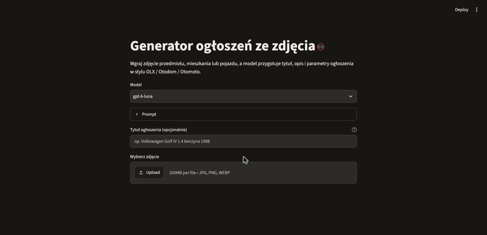
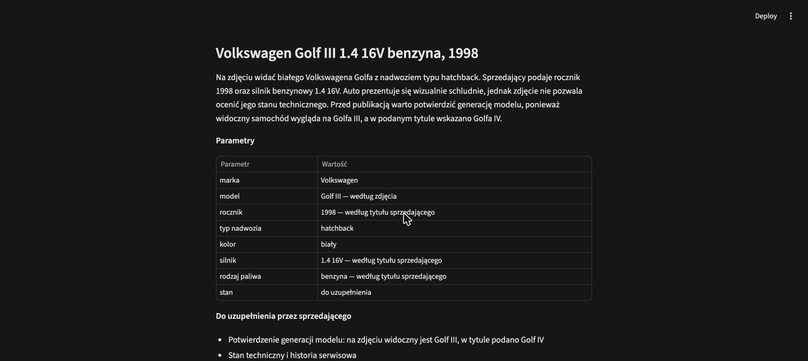

# Projekt 3, etap 1: generator ogłoszeń ze zdjęcia (Streamlit + OpenAI)

## Co zostało zaimplementowane

Na bazie template'u `streamlit_image_processing` zbudowaliśmy działającą lokalnie aplikację (część 1 projektu):

- wgranie zdjęcia (jpg, png, webp) i wybór modelu OpenAI (`gpt-6-luna`, `gpt-6.1-terra`, `gpt-6.2-sol`, `gpt-4.1-mini`);
- nowy prompt: model rozpoznaje typ obiektu, dobiera platformę (Otodom / Otomoto / OLX) i zwraca JSON z **tytułem, opisem, parametrami** i listą informacji **do uzupełnienia** przez sprzedającego;
- **rozszerzenie:** opcjonalne pole „Tytuł ogłoszenia”; jego fakty trafiają do opisu i parametrów;
- wynik jako sformatowane ogłoszenie (tytuł, opis, tabela parametrów), pod nim czas odpowiedzi i liczba tokenów, a w rozwijanym panelu surowy JSON;
- zdjęcie zmniejszane do 1024 px przed wysłaniem (niższy koszt);
- skrypt `porownanie.py`: 5 zdjęć × 4 modele bez tytułu oraz 5 zdjęć z tytułem; wyniki w `wyniki/porownanie.md` i `wyniki/wyniki.json`.

Zdjęcia testowe (Wikimedia Commons, wolne licencje): salon, kuchnia, Volkswagen Golf, czerwona sofa, motocykl enduro.

## Screeny UI

## Przykładowy wynik (`gpt-6-luna`, Golf, z tytułem „Volkswagen Golf IV 1.4 16V benzyna 1998”)

**Volkswagen Golf III 1.4 16V benzyna, 1998**: model przejął z tytułu rocznik i silnik, ale zauważył, że na zdjęciu jest Golf III, a nie IV. Rozbieżność wpisał do „do uzupełnienia” zamiast ją ukryć. Parametry: marka, model (wg zdjęcia), rocznik i silnik (wg tytułu), nadwozie, kolor, stan „do uzupełnienia”.

## Najlepszy prompt

**Bez tytułu** (pełna treść w `utils.py`, `DEFAULT_PROMPT`):

> Jesteś doświadczonym sprzedawcą na OLX, Otodom i Otomoto. Na podstawie zdjęcia przygotuj ogłoszenie sprzedaży.
> 1. Rozpoznaj obiekt i dobierz platformę (nieruchomości - Otodom, pojazdy - Otomoto, pozostałe - OLX).
> 2. Tytuł do 70 znaków, z najważniejszymi cechami, bez wykrzykników i CAPS LOCKA.
> 3. Opis 4-6 zdań, rzeczowo, w stylu prawdziwych ogłoszeń.
> 4. Parametry jak w formularzu danej platformy (osobna lista dla nieruchomości, pojazdów i przedmiotów).
> 5. Tylko to, co widać na zdjęciu lub wynika z tytułu; brak danych - „do uzupełnienia”, szacunek - „ok.”.
> 6. Bez ceny i kontaktu. Zwróć wyłącznie JSON: kategoria, platforma, tytul, opis, parametry, do_uzupelnienia.

**Z tytułem**: ten sam prompt plus:

> Sprzedający podał tytuł ogłoszenia: „…”. Wykorzystaj podane w nim fakty (marka, model, rocznik, metraż, liczba pokoi) w parametrach i opisie. Jeśli tytuł przeczy zdjęciu, opieraj się na zdjęciu i dopisz rozbieżność do „do_uzupelnienia”. Możesz poprawić tytuł stylistycznie, ale zachowaj jego fakty.

Najważniejsza okazała się zasada 5: bez niej modele dopisują metraż, liczbę pokoi czy stan „dobry”, których nie da się ustalić ze zdjęcia.

## Porównanie modeli (5 zdjęć, bez tytułu)

| Model | Śr. czas [s] | Śr. tokeny wyjściowe | Obserwacje |
|---|---|---|---|
| gpt-6-luna | 6,5 | 626 | najdłuższe i najstaranniejsze opisy, trzyma się zasady „tylko to, co widać”; rozpoznał Golfa III |
| gpt-6.1-terra | 7,5 | 445 | podobnie ostrożny, opisy krótsze i bardziej suche |
| gpt-6.2-sol | 7,0 | 333 | najwięcej szczegółów z samego zdjęcia (3 drzwi w Golfie, marka Honda z motocykla), zwięzły |
| gpt-4.1-mini | 3,8 | 237 | najszybszy, ale **zmyśla**: „mieszkanie 2-pokojowe” z jednego zdjęcia, „Honda XR 600 R”, „stan dobry” |

**Wpływ tytułu** (`gpt-6-luna`): tytuł uzupełnia parametry, których nie da się odczytać ze zdjęcia (metraż, liczba pokoi, lokalizacja, rocznik, silnik, model). Pól „do uzupełnienia” jest mniej: średnio 3,8 zamiast 5,4. Opis staje się konkretniejszy. Model nie przyjmuje tytułu bezkrytycznie: przy Golfie zgłosił niezgodność generacji.

## Napotkane problemy

- **Domyślne modele template'u** zwracały opis w dowolnej formie. Dodaliśmy `response_format={"type": "json_object"}`, żeby wynik dało się wyświetlić jako ogłoszenie.
- **Halucynacje:** szybszy `gpt-4.1-mini` podaje fakty niewidoczne na zdjęciu. Trzeba to ograniczać promptem i wyborem modelu.
- **Niejednoznaczne zdjęcia:** zbliżenie kuchni wszystkie modele potraktowały jako ogłoszenie półki, a nie mieszkania. Jedno zdjęcie nie wystarcza do ogłoszenia nieruchomości, tu pomaga tytuł.
- **Modele rozumujące** (gpt-6) zużywają ukryte tokeny, więc limit `max_completion_tokens` podnieśliśmy do 4000.

## Dalsze kroki

Część 2: aplikacja do wyceny mieszkania na modelu z projektu 2 (LightGBM), presety ze zbioru testowego i wyjaśnienie predykcji przez LLM.
