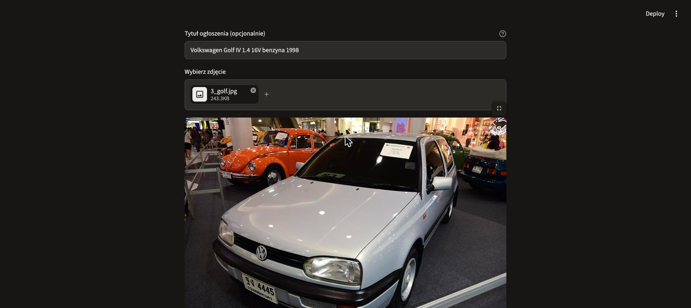

# Projekt 3, etap 1: generator ogłoszeń ze zdjęcia

## Co zrobiliśmy

Na bazie template'u z zajęć zbudowaliśmy aplikację w Streamlit. Użytkownik wgrywa zdjęcie, wybiera model OpenAI
i opcjonalnie wpisuje tytuł. Aplikacja zwraca gotowe ogłoszenie: **tytuł, opis i parametry**, a także listę
informacji, które sprzedający musi dopisać (np. przebieg, metraż). Przetestowaliśmy ją na 5 zdjęciach
(salon, kuchnia, Volkswagen Golf, sofa, motocykl) i 4 modelach.

## Screeny

## Najlepszy prompt

**Bez tytułu:** model ma rozpoznać obiekt, dobrać platformę (Otodom / Otomoto / OLX) i napisać ogłoszenie jak
sprzedający: tytuł do 70 znaków, opis 4-6 zdań bez wzmianek o zdjęciu, parametry jak w formularzu portalu.
Ma podawać tylko to, co widać; resztę oznacza jako „do uzupełnienia”. Wynik w formacie JSON. Pełna treść jest w `utils.py`.

**Z tytułem:** ten sam prompt plus instrukcja, żeby wykorzystać fakty z tytułu (marka, rocznik, metraż), a przy
sprzeczności ze zdjęciem zaufać zdjęciu i zgłosić rozbieżność.

## Porównanie modeli

| Model | Czas [s] | Ocena |
|---|---|---|
| gpt-6-luna | 6,3 | najlepsze opisy, nie zmyśla |
| gpt-6.1-terra | 7,1 | ostrożny, opisy krótsze i suche |
| gpt-6.2-sol | 6,7 | najwięcej szczegółów ze zdjęcia (np. marka motocykla) |
| gpt-4.1-mini | 3,2 | najszybszy, ale zmyśla (np. „2 pokoje”, zły model motocykla) |

**Wpływ tytułu:** opis i parametry są pełniejsze. Model przejmuje z tytułu metraż, liczbę pokoi, rocznik
i silnik, a braków do uzupełnienia jest średnio 2,4 zamiast 4. Przy tytule „Golf IV” model zauważył,
że na zdjęciu jest Golf III, i zgłosił to sprzedającemu.

## Problemy

- Na początku opisy brzmiały jak opis zdjęcia („Na zdjęciu widać…”), a nie jak ogłoszenie. Poprawiliśmy to w promptcie.
- Słabsze modele dopisują fakty, których nie ma na zdjęciu.
- Z jednego zdjęcia nie zawsze wiadomo, co jest sprzedawane: zbliżenie kuchni modele brały za półkę. Tytuł to rozwiązuje.

## Wnioski

Najlepiej sprawdza się `gpt-6-luna`. Tytuł od użytkownika wyraźnie poprawia ogłoszenie, bo uzupełnia
informacje, których nie widać na zdjęciu.
