# Raport techniczny - Projekt 1: model ratingowy z interpretowalnością, wyjaśnialnością i kalibracją do 4%

**Zbiór:** `zbior_13.csv` · **Kod:** `projekt1_rating.ipynb` (wszystkie liczby w raporcie pochodzą z tego notebooka)

## 1. Problem i dane

Budujemy dwa modele szacujące PD - prawdopodobieństwo zdarzenia ryzyka (`default`) dla spółek z o.o. - na podstawie sprawozdań
finansowych: **model interpretowalny** (karta scoringowa WoE + regresja logistyczna) i **black-box** (XGBoost). PD kalibrujemy
statystycznie, dostosowujemy do tendencji centralnej 4%, mapujemy na skalę ratingową i ustalamy próg decyzyjny.

| | Wartość |
|---|---|
| Firmy / defaulty / DR | 3 000 / 445 / 14,8% |
| Cechy surowe | 222 (bilans, RZiS, przepływy, wskaźniki finansowe, 3 wskaźniki branżowe `wsk_index_*`, forma własności, PKD, schemat sprawozdania) |
| Cechy do modelowania | 192 liczbowe + 3 kategoryczne (sekcja PKD, forma własności, wielkość jednostki) = 195 |

### 1.1 Jakość danych (Data Quality)
- ±inf w 3 wskaźnikach (zerowy mianownik) → zamienione na braki; braki występują w 10 kolumnach, w 7 z nich > 50% (przepływy pieniężne) → usunięte.
- 2 kolumny stałe (`szczegolnaFormaPrawna_Symbol` - same spółki z o.o.), 10 prawie stałych i 8 identycznych kolumn - usunięte (na podstawie train).
- Typ sprawozdania: `schemat_wsk_bilans` → cecha kategoryczna `wielkosc` (mikro / mała / pozostałe); `schemat_wsk_rzis` pominięty -
  jest zgodny z `schemat_wsk_bilans` w 97,6% obserwacji. Kod PKD zastąpiony sekcją PKD.
- 182 z 192 cech liczbowych ma skośność |s| > 2, mediana udziału obserwacji poza [Q1 − 3·IQR, Q3 + 3·IQR] to 12,7%. **Polityka:** nie
  usuwamy firm (skrajny wskaźnik to często sygnał ryzyka); karta używa binningu kwantylowego (odporny na ogony), drzewa nie
  wymagają cappingu, siatki PDP ograniczamy do kwantyli 2-98% z train.

### 1.2 Przeciek, wskaźniki branżowe i powtarzające się podmioty
- Żadna cecha nie ma AUC jednowymiarowego > 0,85. Trzy wskaźniki `wsk_index_*` (skreślenia / zawieszenia, nowe i aktywne firmy)
  nie występują w słowniku i mają ok. 3 wartości na kod PKD (średnio 2,98) - to **wskaźniki branżowe liczone dla kilku okresów**.
  Mają najwyższe AUC jednowymiarowe (`wsk_index_nowe` 0,718, `wsk_index_skr_zaw` 0,708) i IV w przedziale „podejrzanie silna”
  (0,61 i 0,58). **Prowadzący potwierdził, że nie zawierają informacji z przyszłości**, więc używamy ich w obu modelach.
  Wnoszą dużo: Gini prostego logitu na valid 0,397 → 0,586, na teście 0,373 → 0,534. Firma nie ma na nie wpływu, a po wdrożeniu
  trzeba je aktualizować dla bieżącego okresu.
- Brak identyfikatora firmy. Par „ta sama firma rok później” (to samo PKD, forma własności, kapitał, wiek różny o pełne lata ±3 dni)
  jest 61 wobec średnio 35 po losowym przemieszaniu wieku - część firm prawdopodobnie się powtarza. Stosujemy **podział grupowy**:
  51 grup wieloelementowych (109 firm) trafia w całości do jednego zbioru i jednego foldu.

### 1.3 Schemat walidacji

```
              ┌──────────── train 60% (1 801) ─────────┐┌─ valid 20% (600) ─┐┌─ test 20% (599) ─┐
dane (3000) → │ uczenie modeli, binning / WoE,         ││ kalibracja kształtu,││ wyłącznie ocena  │
              │ selekcja cech, strojenie:              ││ δ i próg na valid   ││ końcowa          │
              │ StratifiedGroupKFold(5) wewnątrz train ││ ważonym do DR 4%    ││                  │
              └─────────────────────────────────────────┘└─────────────────────┘└──────────────────┘
```

Podział `StratifiedGroupKFold` (DR 14,8% w każdym zbiorze, 0 wspólnych grup). Wszystkie przekształcenia wymagające dopasowania
liczone są na train (w CV - na foldach treningowych); test nie bierze udziału w żadnej decyzji. Podział: `wyniki/podzial.csv`.

## 2. EDA
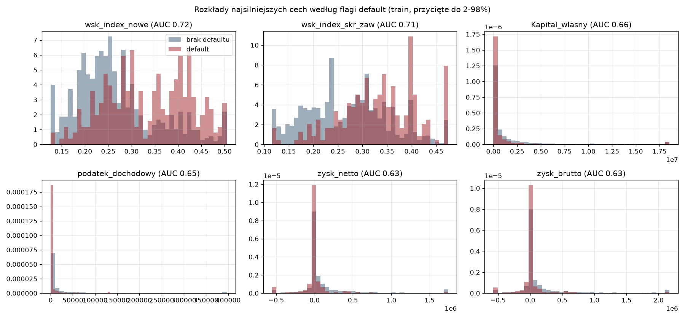
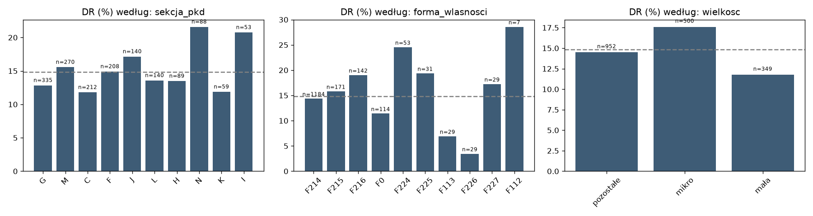

- Najsilniejsze pojedyncze cechy: wskaźniki branżowe `wsk_index_nowe` i `wsk_index_skr_zaw` (AUC 0,71-0,72), dalej kapitał własny,
  podatek dochodowy, zysk netto i brutto, EBITDA, ROA (AUC 0,63-0,66).
- DR różni się między sekcjami PKD (12-22%), formami własności i wielkością jednostki (mała 11,9%, mikro 16,8%).
- Korelacje: 219 par cech ma |ρ Spearmana| > 0,9, 937 par > 0,7 - wiele wskaźników to warianty tej samej miary. Ma to znaczenie
  dla selekcji cech karty, podziału wkładów SHAP, ważności permutacyjnej i analizy kontrfaktycznej.

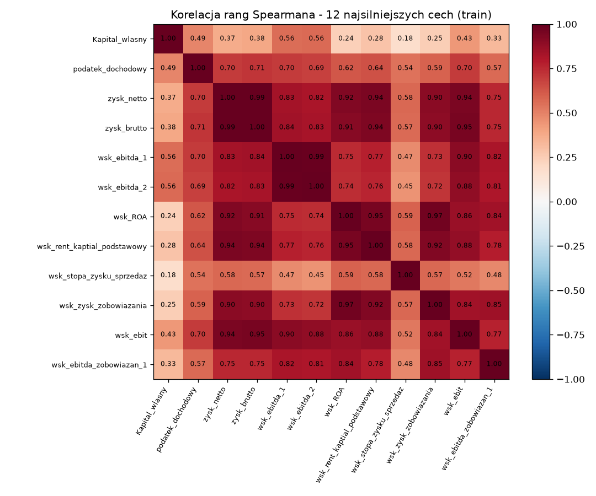

## 3. Model interpretowalny: karta scoringowa

**Przygotowanie cech (train):** binning monotoniczny (`WoEBinner` z Lab 1: ≤ 5 przedziałów, ≥ 5% obserwacji, osobny przedział
`BRAK`), WoE = ln(%dobrych / %złych). **Selekcja:** IV ≥ 0,1 (85 cech) → filtr korelacji |ρ| < 0,6 między WoE (12 cech) →
liczba cech wybrana 5-krotną CV (najwyższe AUC przy k = 8; reguła 1 błędu std. dałaby 3 cechy, co pomija całe obszary oceny).
`wsk_index_skr_zaw` nie wchodzi do karty - jest skorelowany z `wsk_index_nowe` (|ρ| = 0,65).

| Cecha | Obszar | IV | β | p-value | VIF |
|---|---|---|---|---|---|
| wsk_index_nowe | wskaźnik branżowy | 0,610 | −0,938 | < 0,001 | 1,03 |
| podatek_dochodowy | RZiS (proxy zysku) | 0,366 | −0,512 | 0,004 | 2,19 |
| Kapital_wlasny | bilans | 0,322 | −0,434 | 0,009 | 1,79 |
| wsk_ogolnego_zadluzenia_1 | zadłużenie | 0,291 | −0,725 | < 0,001 | 1,22 |
| wsk_zysk_zobowiazania | rentowność | 0,246 | −0,147 | 0,449 | 1,76 |
| wsk_stopa_zysku_sprzedaz | rentowność | 0,220 | −0,403 | 0,040 | 1,71 |
| wsk_sytuacji_fin | sytuacja finansowa | 0,176 | −0,185 | 0,324 | 1,27 |
| pozostale_przychody_oper | RZiS | 0,174 | −0,248 | 0,237 | 1,48 |

- **Znaki:** wszystkie β < 0, zgodnie z konwencją WoE (wyższe WoE = niższe ryzyko) i z intuicją ekonomiczną. **VIF** < 2,2.
- **Istotność β:** pięć cech ma p < 0,05; trzy najsłabsze (`wsk_zysk_zobowiazania`, `wsk_sytuacji_fin`, `pozostale_przychody_oper`)
  są nieistotne pojedynczo przy skorelowanych sąsiadach, ale liczbę cech wybrano w CV, a ich znaki są poprawne i stabilne.
- **Monotoniczność na nowych danych:** na valid 23 z 29 zmian DR między sąsiednimi przedziałami ma ten sam kierunek co na train.
- **Stabilność w CV:** Gini 0,546 ± 0,105; znaki β ujemne w 39 z 40 przypadków (wyjątek: najsłabsza `wsk_zysk_zobowiazania`, 4 / 5).
- **Karta punktowa:** 600 pkt przy szansach 50:1, PDO = 20; wynik na teście 463-623 pkt (mediana 554), suma punktów zgodna z modelem (sprawdzone).

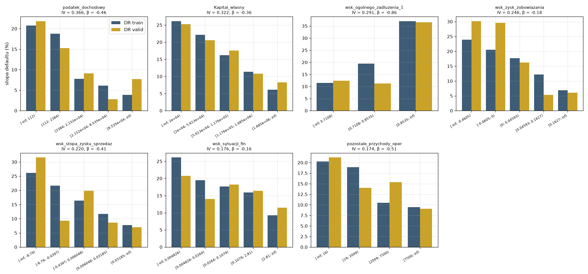

## 4. Model black-box: XGBoost

Wszystkie 195 cech (kategorie one-hot, rzadkie poziomy łączone), bez wag klas. **Strojenie:** losowe przeszukiwanie 40 konfiguracji
w 5-krotnej grupowej CV na train, kryterium log-loss. Wybrano: 800 drzew, głębokość 5, `learning_rate` 0,01, `min_child_weight` 5,
`subsample` 0,6, `colsample_bytree` 0,5, λ = 5, γ = 2 (`wyniki/xgboost_parametry.json`). **Kontrola przeuczenia:** AUC na foldach
treningowych 0,969 vs 0,791 w CV - luka 0,18 jest duża (konfiguracje z mocniejszą regularyzacją mają ok. 0,09-0,10), ale różnice
log-loss w CV między 8 najlepszymi konfiguracjami nie przekraczają 0,002; wybór wyłącznie według CV (log-loss 0,350).

## 5. Porównanie jakości

| Test (599 firm, 89 defaultów) | Karta | XGBoost |
|---|---|---|
| AUC [95% CI bootstrap] | 0,781 [0,724; 0,833] | 0,792 [0,737; 0,842] |
| Gini | 0,562 | 0,583 |
| KS | 0,440 | 0,457 |
| PR-AUC (losowy: 0,149) | 0,430 | 0,458 |
| log-loss | 0,350 | 0,347 |
| Brier | 0,105 | 0,104 |
| Gini w CV (5 foldów) | 0,546 ± 0,105 | 0,581 ± 0,083 |
| Złożoność | 8 cech, 9 parametrów, 37 przedziałów | 179 używanych cech, 800 drzew, 7 583 liści |

Różnica Gini XGBoost − karta (sparowany bootstrap): test **+0,021 [−0,048; +0,089]**, valid **+0,072 [+0,019; +0,120]**.
Przewaga black-boxa jest **mała i niepewna**: istotna na valid, ale na teście przedział obejmuje zero, a rozrzut Gini między foldami CV
(karta 0,43-0,66, XGBoost 0,49-0,66) jest kilka razy większy niż różnica między modelami.

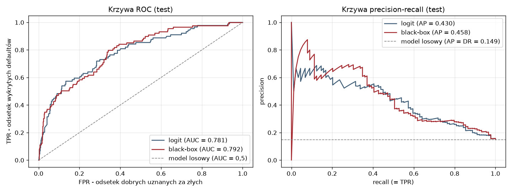

## 6. Interpretowalność i wyjaśnialność

**Ustawienia:** SHAP w log-szansach. Karta - wzór zamknięty φ_j = β_j·(WoE_j − E[WoE_j]), tło: train. XGBoost - `TreeExplainer`,
wariant **interventional** z tłem 300 firm z train - ta sama (interwencyjna) funkcja wartości co wzór zamknięty karty (wykład 4);
przy 219 parach cech z |ρ| > 0,9 `tree_path_dependent` przybliżałby funkcję warunkową z dużym błędem. Wariant path-dependent
stosujemy tylko do wartości interakcji SHAP (6.4). Kolumny one-hot sumowane do cechy źródłowej. Addytywność: maks. błąd 5·10⁻⁶
(XGBoost), 2·10⁻¹⁵ (karta). Wartość bazowa φ₀: −2,562 (XGBoost), −2,215 (karta) - σ(φ₀) nie jest średnim PD (14,8%).

### 6.1 Wyjaśnienia globalne - najważniejsze cechy

| # | Cecha (XGBoost, średnie \|SHAP\|) | Kierunek (ρ z default, train) | Komentarz ekonomiczny |
|---|---|---|---|
| 1 | wsk_index_nowe (w karcie) | ↑ ryzyko | napływ nowych firm w branży - wysoka rotacja i konkurencja |
| 2 | wsk_index_skr_zaw | ↑ ryzyko | odsetek skreśleń i zawieszeń w branży - kondycja branży w danym okresie |
| 3 | pozostale_przychody_oper (w karcie) | ↓ ryzyko | dodatkowe źródła przychodu, aktywna działalność |
| 4 | Kapital_wlasny (w karcie) | ↓ ryzyko | bufor na straty |
| 5 | podatek_dochodowy (w karcie) | ↓ ryzyko | podatek płacą firmy z zyskiem - miara rentowności i skali |
| 6 | wsk_liczba_dni_istnienia | ↓ ryzyko (słaby) | staż firmy |
| 7 | wsk_zast_kapitalu_podstawowego | ↑ ryzyko | kapitał podstawowy względem własnego - wysoka wartość oznacza, że straty „zjadły” kapitał |
| 8 | Kapital_zapasowy | ↓ ryzyko (słaby) | zatrzymane zyski z lat ubiegłych |
| 9 | wsk_koszty_przychody | ↑ ryzyko | koszty względem przychodów - niska marża |
| 10 | wsk_index_aktywne | ↑ ryzyko (słaby) | trzeci wskaźnik branżowy - dynamika aktywnych firm w branży |

Kierunki (korelacja rang z default na train) są zgodne z intuicją ekonomiczną. **Spójność z kartą:** dwie najważniejsze cechy
XGBoost to wskaźniki branżowe, a 4 z 5 pierwszych cech są w karcie. Po zgrupowaniu skorelowanych wskaźników w tematy oba modele
opierają się na tych samych obszarach (branża, zadłużenie, kapitał, rentowność, zysk, przychody) - korelacja rang tematów 0,62.
Ok. połowa (54%) wkładu XGBoost pochodzi z cech spoza tematów karty, w tym z `wsk_index_skr_zaw` i `wsk_index_aktywne`, których karta
nie zawiera. Zgodność rankingu SHAP z ważnością permutacyjną dla 195 cech jest niska (ρ = 0,14) - permutacja pojedynczej cechy zaniża
znaczenie cech mających skorelowanych „bliźniaków” (np. `pozostale_przychody_oper`, `wsk_koszty_przychody`: 3. i 9. miejsce według SHAP,
ujemna ważność permutacyjna).

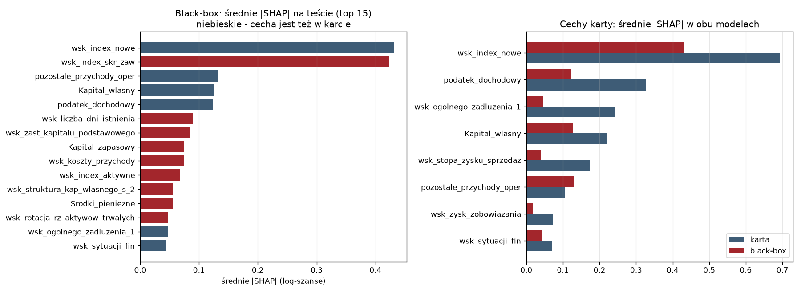
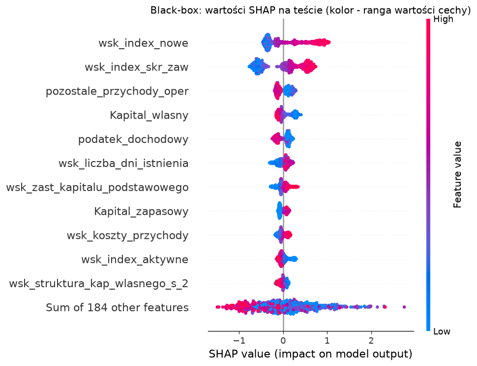

### 6.2 Ważność grup skorelowanych cech (Lab 6)

Tematy z 6.1 (grupy cech skorelowanych |ρ| ≥ 0,7 z cechą karty) oceniamy dwiema metodami z Lab 6: **permutacja grupowa** (cała grupa
mieszana tą samą permutacją, valid, 5 powtórzeń) i **drop-column** (XGBoost uczony od nowa bez grupy). MDI pomijamy - jest liczone
na danych uczących i premiuje cechy ciągłe. AUC black-boxa na valid: 0,833.

| Grupa (liczba cech) | Permutacja grupy (spadek AUC) | Suma permutacji pojedynczych | Drop-column grupy | Suma \|SHAP\| |
|---|---|---|---|---|
| pozostałe cechy (129) | 0,080 | 0,061 | 0,026 | 2,07 |
| wsk_index_nowe (1) | 0,050 | 0,040 | 0,009 | 0,43 |
| zadłużenie ogólne (17) | 0,022 | 0,002 | 0,000 | 0,33 |
| podatek dochodowy (2) | 0,005 | 0,003 | −0,002 | 0,14 |
| zysk / zobowiązania (30) | 0,005 | 0,003 | 0,003 | 0,31 |
| kapitał własny (8) | 0,002 | 0,002 | −0,002 | 0,31 |

- **Efekt bliźniaków:** grupa zadłużenia ma permutację grupową 0,022 przy sumie permutacji pojedynczych 0,002 - model korzysta
  z niej wyraźnie, ale pojedyncza permutacja tego nie widzi, bo informację przenoszą pozostałe cechy grupy.
- **Drop-column** jest bliski zera lub ujemny dla większości grup: po usunięciu grupy model odtwarza informację z innych cech
  (permutacja mierzy „czy model korzysta”, drop-column - „czy informację da się zastąpić”). Tylko wskaźnik branżowy i reszta cech
  są nie do zastąpienia (wyraźnie dodatni drop-column).
- Zgodność rang grup: permutacja grupowa vs suma |SHAP| ρ = 0,70, permutacja vs drop-column ρ = 0,92. Na poziomie grup SHAP
  i permutacja są dużo bardziej zgodne niż dla pojedynczych cech (ρ = 0,14) - rozbieżność z 6.1 wynika z korelacji cech, nie z błędu metod.

### 6.3 PDP / ICE / ALE

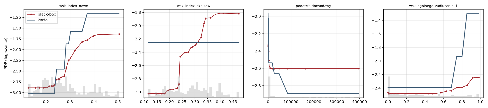
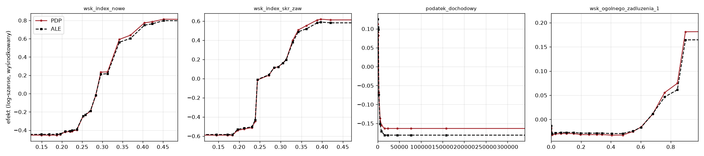

- Kierunki PDP obu modeli są zgodne dla czterech głównych cech (`wsk_index_nowe`, `wsk_index_skr_zaw`, podatek, zadłużenie);
  black-box ma krzywe nasycające się, karta - schodki.
- **c-ICE:** wzrost `wsk_index_nowe` z 0,126 do 0,505 podnosi log-szanse średnio o +1,25 (10% firm < +0,92, 10% > +1,56); efekt jest
  podobny w grupach wielkości (mikro +1,24, mała +1,17, pozostałe +1,29) - brak wyraźnej interakcji z wielkością.
- **ALE** (K = 20 przedziałów kwantylowych, min. 20-28 firm w przedziale): różnica PDP - ALE to 3-9% zakresu efektu, mimo silnych
  korelacji (dla zadłużenia ρ = 0,996 z innym wskaźnikiem). PDP nie jest więc tu istotnie zniekształcone przez korelacje.
- **Monotoniczność XGBoost:** brak naruszeń dla podatku i zysku / zobowiązania; pomijalne dla `wsk_index_*` (≤ 0,6% zmienności PDP),
  kapitału (1,1%) i rentowności sprzedaży (2,2%); większe dla zadłużenia (6,7%), `wsk_sytuacji_fin` (25%) i `pozostale_przychody_oper`
  (28%, maks. 0,099 log-szans) - kandydaci do `monotone_constraints`. Wiek firmy (`wsk_liczba_dni_istnienia`) w 83% zmienności PDP
  idzie wbrew oczekiwanemu kierunkowi (maks. 0,086 log-szans). Znaki β karty są zgodne z oczekiwanymi kierunkami dla wszystkich 8 cech.

### 6.4 Interakcje: statystyka H Friedmana (Lab 6)

Kandydatów wybieramy z wartości interakcji SHAP (path-dependent, 300 firm z testu) - 4 pary o największej średniej |interakcji|.
Każdą parę weryfikujemy **statystyką H Friedmana** (Lab 6) w log-szansach, na **dwóch niezależnych próbach** po 150 firm, razem
z **parą kontrolną** (dwie ważne cechy o najmniejszej interakcji SHAP) wyznaczającą poziom szumu metody.

| Para | Interakcja SHAP | H (próba 1 / 2) | RMS log-szans (próba 1 / 2) |
|---|---|---|---|
| wsk_index_nowe × wsk_liczba_dni_istnienia | 0,028 | 0,061 / 0,060 | 0,033 / 0,030 |
| wsk_index_nowe × podatek_dochodowy | 0,026 | 0,055 / 0,063 | 0,030 / 0,031 |
| wsk_index_nowe × wsk_sytuacji_fin | 0,026 | 0,050 / 0,053 | 0,026 / 0,026 |
| wsk_index_skr_zaw × pozostale_przychody_oper | 0,023 | 0,044 / 0,043 | 0,023 / 0,022 |
| kontrolna: podatek_dochodowy × Kapital_zapasowy | 0,000 | 0,004 / 0,003 | 0,000 / 0,000 |

Interakcje są **rzeczywiste** (powtarzalne na obu próbach, ponad 10 razy powyżej pary kontrolnej, której H = 0,003-0,004 wyznacza
poziom szumu metody), ale **słabe**: H ≤ 0,063, a udział interakcji w zmienności wspólnej funkcji zależności pary to H², czyli
najwyżej ok. 0,4% (przy H ≈ 0,06); RMS ≤ 0,033 log-szans. Model jest w praktyce prawie addytywny - to wspiera wybór addytywnej
karty scoringowej.

### 6.5 Global surrogate: drzewo naśladujące black-box (Lab 6)

Drzewo regresyjne uczone na log-szansach XGBoost w train (min. 50 firm w liściu), PD drzewa przechodzi ten sam łańcuch kalibracji
i δ. Wierność na teście (39 firm odrzuconych przez XGBoost przy jego progu operacyjnym z sekcji 8):

| Głębokość | Liście | Wierność R² | Zgodność decyzji | Odrzuceni przez XGBoost odrzuceni też przez drzewo | Zgodność klas | Gini drzewa |
|---|---|---|---|---|---|---|
| 2 | 4 | 0,525 | 93,5% | 0% | 41,2% | 0,350 |
| 3 | 8 | 0,631 | 95,0% | 35,9% | 39,9% | 0,426 |
| 4 | 16 | 0,700 | 94,7% | 20,5% | 42,6% | 0,489 |
| 5 | 22 | 0,733 | 94,7% | 20,5% | 49,1% | 0,493 |
| 8 | 28 | 0,737 | 94,7% | 20,5% | 47,7% | 0,473 |

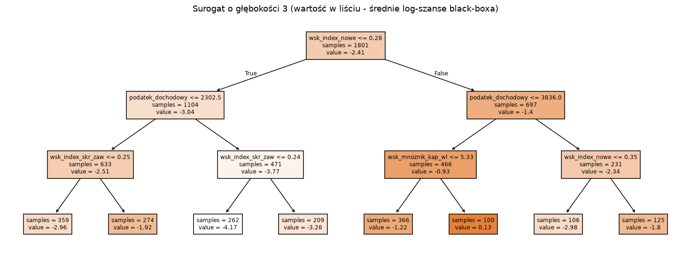

- Drzewo o głębokości 3 dzieli najpierw według `wsk_index_nowe` (≤ 0,282), potem według podatku dochodowego (2,3-3,8 tys. zł),
  `wsk_index_skr_zaw` (ok. 0,25) i mnożnika kapitału własnego (`wsk_mnoznik_kap_wl` 5,33); PD modelu końcowego w liściach 0,5-25,3%.
- Wysoka **zgodność decyzji ogółem (94-95%) jest myląca** - większość firm jest przyjmowana. Drzewo odtwarza tylko 21-36%
  odrzuceń black-boxa, a klasy ratingowe zgadzają się dla 40-49% firm. Surogat nadaje się do komunikacji (reguły dla komitetu),
  nie do decyzji ani jako wyjaśnienie pojedynczej odmowy. Nawet najlepsze drzewo (Gini 0,493) nie dorównuje karcie (0,562).

### 6.6 Wyjaśnienia lokalne - studia przypadków (test)

| Przypadek | PD XGBoost | PD karta | Default | Główne czynniki (SHAP / karta) |
|---|---|---|---|---|
| najwyższe PD | 80,3% | 68,2% | nie | wysokie wskaźniki branżowe (`wsk_index_nowe` 0,47: +0,73, `wsk_index_skr_zaw` 0,35: +0,53), kapitał własny 4,3 tys. zł (+0,31), ujemna ROE brutto, zadłużenie 98,2% aktywów; karta: dodatkowo brak zysku (zerowy podatek) |
| **graniczna** (PD ≈ p* = 18,2%) | 18,2% | 17,9% | nie | ↑ `wsk_index_nowe` 0,30 (+0,42), wiek firmy (+0,16), `wsk_index_skr_zaw` 0,29 (+0,14), niski podatek (362 zł, +0,13), `wsk_zast_kapitalu_podstawowego` = 50 (+0,10) |
| typowa przyjęta | 7,2% | 9,1% | nie | ↓ niski `wsk_index_skr_zaw` 0,17 (−0,67), pozostałe przychody 24,9 tys. zł (−0,16); ↑ `wsk_zast_kapitalu_podstawowego` = 1 000 (+0,34), zerowy podatek (+0,14) |
| niezgodność modeli | 22,5% | 3,4% | tak | XGBoost: wysoki `wsk_index_skr_zaw` 0,44 (+0,69 log-szans; brak w karcie) i mały kapitał (28,4 tys. zł, +0,27); karta: niski `wsk_index_nowe` (0,20) daje 94,9 pkt (maksimum) |

Dla karty wyjaśnienie jest bezpośrednie: punkty każdej cechy i „utracone punkty względem maksimum” (kody przyczyn). Dla XGBoost:
wykres kaskadowy SHAP, kody przyczyn, LIME i analiza „what-if”. **Wniosek operacyjny:** firmy z dużą różnicą ocen obu modeli
(przypadek 4 - firma, u której faktycznie wystąpił default) powinny trafiać do analityka.

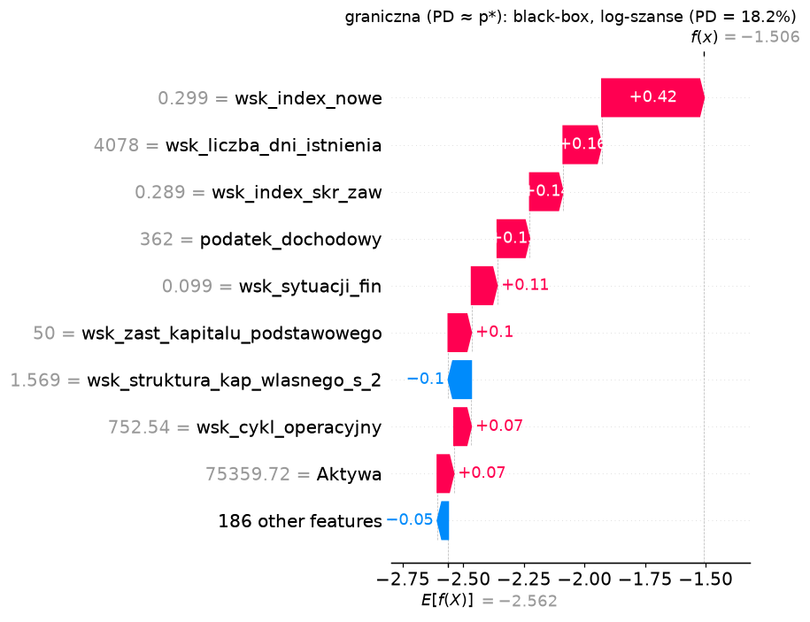
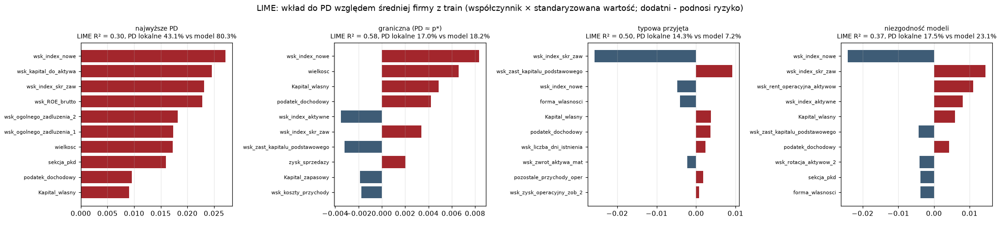

### 6.7 Wierność wyjaśnień (fidelity)
- **SHAP - test usuwania:** zastąpienie wartością typową najważniejszej według SHAP cechy zmienia log-szanse średnio o 0,65, losowej -
  o 0,020; dla 10 cech: 0,99 vs 0,12. Ranking SHAP wiernie wskazuje cechy, od których zależy prognoza.
- **LIME - lokalne R² i błąd aproksymacji** (20 firm, nowe otoczenie losowane jak w LIME):

| Szerokość jądra | R² LIME (mediana) | R² ważone, nowe otoczenie | MAE (pp PD) | \|PD lokalne − PD modelu\| w punkcie (pp) |
|---|---|---|---|---|
| 0,25 × domyślna | 0,02 | −2,77 | 9,0 | 0,07 |
| 0,5 × domyślna | 0,46 | 0,47 | 3,9 | 7,6 |
| 1 × domyślna | 0,47 | 0,49 | 3,9 | 8,6 |
| 2 × domyślna | 0,48 | 0,48 | 3,9 | 8,6 |

Liniowy model zastępczy wyjaśnia ok. połowy zmienności PD XGBoost w otoczeniu firmy, ale w samym punkcie myli się średnio o ok. 8-9 pp.
LIME losuje próbki z odchyleniem standardowym całego train w każdej z ok. 195 cech, więc otoczenie jest szerokie - próbki leżą daleko
od firmy. W tylu wymiarach odległości próbek od firmy są prawie jednakowe, więc wagi jądra są prawie płaskie i szerokość jądra
(0,5-2 × domyślna) prawie nic nie zmienia; przy 0,25 × domyślnej istotną wagę ma za mało próbek - zgodność w punkcie jest pozorna,
a R² na nowym otoczeniu ujemne. **Wyjaśnienia LIME mogą być niepełne lub mylące** - zwłaszcza blisko progu decyzyjnego; przyczyną
jest też schodkowy model w 195 wymiarach. Wkład cechy w LIME liczymy jako współczynnik × standaryzowana wartość firmy (względem
średniej z train), więc - jak SHAP - względem przeciętnej firmy. LIME i SHAP wskazują częściowo różne cechy (Jaccard top-5 0,25-0,67),
ale wśród wspólnych cech kierunek wpływu w większości się zgadza (8 / 8, 3 / 4, 5 / 6, 4 / 5).

### 6.8 Stabilność wyjaśnień
| Eksperyment | Miara | Wynik | Źródło zmienności |
|---|---|---|---|
| LIME, 10 ziaren, ta sama firma: 1 000 / 5 000 / 20 000 próbek | Jaccard top-5 | 0,49-0,58 / 0,56-0,83 / 0,80-1,00 | metoda (losowanie) |
| | Spearman wag | 0,57-0,75 / 0,76-0,93 / 0,93-0,97 | |
| SHAP XGBoost, model uczony na 5 foldach | Jaccard top-5 / top-10 | 0,58 / 0,61; ρ rang 0,78 | model (wybór skorelowanych cech) |
| SHAP XGBoost, grupy tematyczne | Jaccard top-3 | 0,70; ρ rang 0,90 | model |
| Karta, 5 foldów | Jaccard top-3 | 0,60; ρ rang 0,83; znaki β 39/40 | model (mało defaultów) |

LIME stabilizuje się dopiero przy 20 000 próbek, a stabilność nie oznacza wierności. TreeSHAP jest deterministyczny - zmienność
rankingu wynika z modelu: przy 190 skorelowanych wskaźnikach boosting w każdym foldzie wybiera inne „bliźniacze” cechy, a ranking
**grup** jest stabilniejszy (ρ rang 0,90 wobec 0,78 dla cech). Dlatego monitoring wyjaśnień prowadzimy na poziomie grup (sekcja 10).
**Ograniczenia SHAP / LIME:** podział wkładu między skorelowane cechy jest umowny (zależy od wariantu SHAP i struktury drzew),
a wyjaśnienia opisują model, nie zależności przyczynowe.

## 7. Kalibracja

### 7.1 Kalibracja statystyczna (pre-cal → post-cal)
| Valid (przed) | DR | średnie PD | Brier | log-loss | ECE | CITL a | slope b |
|---|---|---|---|---|---|---|---|
| karta | 14,8% | 13,5% | 0,1031 | 0,340 | 0,029 | 0,13 | 1,06 |
| XGBoost | 14,8% | 12,8% | 0,1000 | 0,324 | 0,024 | 0,21 | 1,04 |

Wybór metody - 5-krotna CV wewnątrz valid (log-loss): karta - bez kalibracji 0,3402, Platt 0,3444, beta 0,3447, izotoniczna 0,4002;
XGBoost - 0,3240 / 0,3274 / 0,3280 / 0,3496. **Kształt jest poprawny** (modele bez wag klas), izotoniczna przeucza się przy 89
defaultach → bez korekty kształtu. Na teście Platt i beta przestrzeliwują średnią (PD 16,2-16,3% przy DR 14,9%, CITL −0,13 do −0,15)
i pogarszają log-loss - potwierdzenie decyzji.

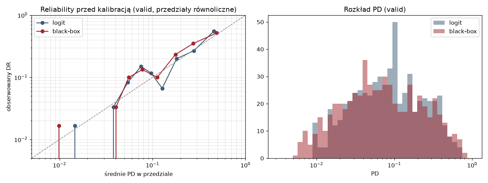
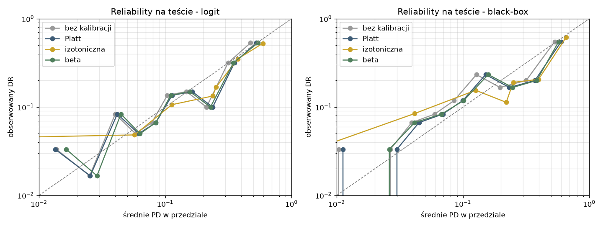

### 7.2 Dostosowanie do tendencji centralnej 4%
logit(q) = logit(p) + δ, δ wyznaczone na valid przeważonym do DR = 4% (portfel docelowy; wagi: default 0,04 / DR, brak defaultu
0,96 / (1 − DR)) tak, by średnie PD wyniosło tam 4%: **−1,280** (karta), **−1,218** (XGBoost). Wzór korekty a priori
(logit 4% − logit DR próby) dałby −1,430 - silniejsze przesunięcie, bo na valid oba modele już lekko zaniżają poziom (CITL 0,13 / 0,21).
Na valid bez wag średnie PD po δ wynosi 4,8% (karta) i 5,0% (XGBoost).

| Test | średnie PD | DR | AUC | Brier | log-loss | CITL a | slope b |
|---|---|---|---|---|---|---|---|
| karta - przed δ | 14,7% | 14,9% | 0,781 | 0,105 | 0,350 | 0,02 | 0,95 |
| karta - po δ (4%) | 5,3% | 14,9% | 0,781 | 0,121 | 0,420 | 1,30 | 0,95 |
| XGBoost - przed δ | 14,1% | 14,9% | 0,792 | 0,104 | 0,347 | 0,07 | 0,83 |
| XGBoost - po δ (4%) | 5,7% | 14,9% | 0,792 | 0,117 | 0,413 | 1,29 | 0,83 |
| karta - po δ, test przeważony do DR 4% | 4,5% | 4,0% | - | 0,036 | 0,146 | −0,13 | 0,97 |
| XGBoost - po δ, test przeważony do DR 4% | 4,6% | 4,0% | - | 0,036 | 0,145 | −0,17 | 0,85 |

- Ranking i AUC się nie zmieniają; zmienia się poziom PD. Względem próby (DR 14,9%) kalibracja **pogarsza się z założenia**:
  dostosowanie średniej do 4% nie jest poprawą kalibracji statystycznej.
- Po przeważeniu testu do DR = 4% (zmiana tylko udziału defaultów) PD po δ jest bliskie skalibrowania: średnie PD 4,5% / 4,6% przy
  DR 4,0%, CITL −0,13 / −0,17 - lekkie zawyżenie (bez δ: −1,41 / −1,38).
  Dostosowanie jest więc poprawne, jeśli portfel docelowy różni się od próby tylko udziałem defaultów (np. próba celowo wzbogacona
  o upadłe firmy). Jeśli wysoki DR wynika z gorszego okresu, PD po δ zaniża ryzyko w podobnych okresach - to cecha PD through-the-cycle.

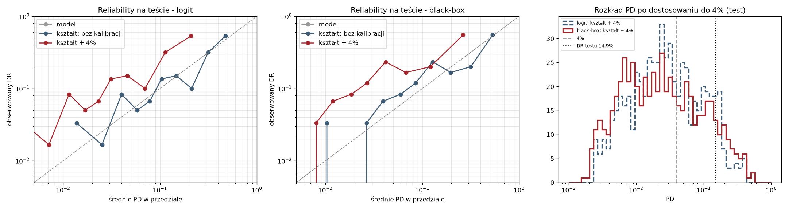

## 8. Progi decyzyjne i ratingi

**Skala:** AAA < 1%, AA 1-2%, A 2-5%, BBB 5-8%, BB 8-12%, B 12-20%, CCC ≥ 20%, D - stwierdzony default.
Rozkład (karta / XGBoost, test ważony do DR 4%): AAA 23,5% / 34,4%, AA 20,9% / 16,4%, A 25,9% / 21,5%, BBB 11,7% / 9,8%,
BB-CCC 17,9% / 18,0%; HHI 0,19 / 0,21.
**Monotoniczność (test ważony do DR 4%):** DR karty rośnie od 0,8% (AAA) do 32,3% (CCC); w XGBoost DR nie jest monotoniczny -
A 4,6%, BBB 3,7%, BB 3,3% (8 i 5 defaultów w klasach BBB i BB).
**Backtest (test Jeffreysa, test ważony do DR 4%, PD po δ):** wszystkie 7 klas zielonych w obu modelach. Dla porównania test bez wag
z PD bez δ: karta - 7 klas zielonych, XGBoost - 5 zielonych, 1 żółta, 1 czerwona.

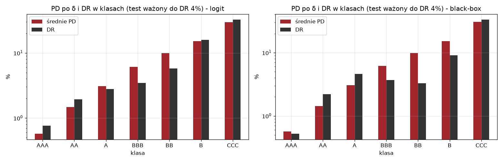

**Funkcja zysku** (marża 10%, LGD 45%, jednakowa ekspozycja): przyjęty dobry +0,10, przyjęty zły −0,45, odrzucony 0;
p* = 0,10 / 0,55 = 18,2%. **Próg empiryczny wyznaczamy na valid przeważonym do DR = 4%** (wykład 3: najpierw δ, potem próg) - na tym
portfelu wyznaczono δ, więc na nim liczymy zysk. Wynik: **15,0% (karta), 20,5% (XGBoost)** - po obu stronach p*.

| Test | Próg | Akceptacja | DR wśród przyjętych | Zysk |
|---|---|---|---|---|
| karta - portfel 4%, próg z valid | 15,0% | 93,9% | 2,8% | 47,5 |
| XGBoost - portfel 4%, próg z valid | 20,5% | 96,5% | 2,9% | 48,6 |
| portfel 4%, p* (karta / XGBoost) | 18,2% | 97,4% / 94,8% | 3,4% / 2,7% | 47,5 / 48,2 |
| portfel 4%, przyjmij wszystkich | - | 100% | 4,0% | 46,7 |
| portfel jak próba, p* na PD bez δ (karta / XGBoost) | 18,2% | 72,5% / 73,8% | 7,8% / 8,4% | 24,7 / 23,9 |
| portfel jak próba, przyjmij wszystkich | - | 100% | 14,9% | 11,0 |

Wyniki dla portfela 4% są ważone (test przeważony do DR 4%, suma wag 599). Próg empiryczny i p* dają prawie ten sam zysk -
przy portfelu o DR 4% model odrzuca tylko 3-6% najgorszych firm, a krzywe zysku są płaskie wokół optimum, więc położenie maksimum
jest mało precyzyjne (progi 15,0% i 20,5%) i nie świadczy o kalibracji PD.
**Tabela decyzyjna (karta, test bez wag, PD po δ):** obniżanie progu z 20% do 3% zmniejsza akceptację z 96,5% do 54,8%, a DR wśród
przyjętych z 13,0% do 5,5%; liczba odrzuconych dobrych firm rośnie szybciej niż unikniętych złych (jeden uniknięty default „kosztuje”
4,5 dobrej firmy): między progami 8% a 3% odrzucamy 20 złych firm więcej, ale 117 dobrych więcej. Na tym portfelu zysk jest najwyższy
przy progu 8% (25,6), a przy progu operacyjnym 15,0% wynosi 21,95.
**Porównanie decyzji (test, progi z valid):** zgodność decyzji 92,3%, ten sam rating 45,9%, różnica ≤ 1 klasa 88,5%; z 46 firm
o różnej decyzji 31 odrzuca tylko karta (DR wśród nich 41,9%), 15 - tylko XGBoost. Przy tej samej stopie akceptacji (93,5% / 90,8%)
decyzje zgadzają się w 93,8% / 92,3%, a zysk XGBoost jest wyższy o 2,7 / 1,65 jednostki.

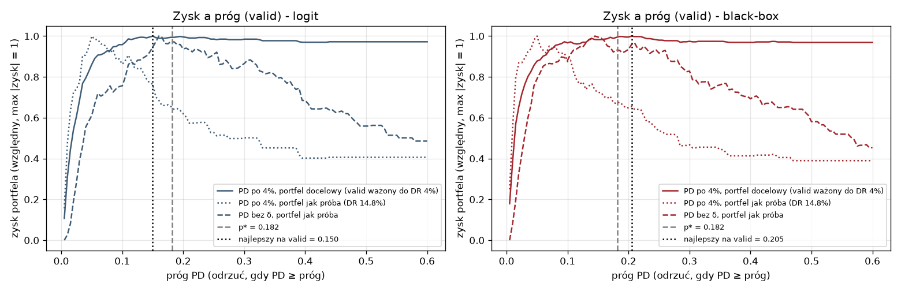

### 8.1 Firma graniczna przy progu operacyjnym: SHAP modelu końcowego

Modelem końcowym jest karta scoringowa (sekcja 11), a decyzję podejmujemy na jej PD po δ i progu 15,0%, więc firmę graniczną wybieramy
właśnie tam. Kształtu nie kalibrujemy, a δ jest stałym przesunięciem logitu, więc **SHAP modelu końcowego = te same wkłady φ karty,
wartość bazowa φ₀ + δ = −3,495** (wykład 4); kontrola: φ₀ + δ + Σφ = −1,736 = logit PD końcowego.

Firma (wiersz testu 318): PD końcowe 14,99% (tuż poniżej progu - przyjęta), rating B, bez defaultu (XGBoost: PD po δ 12,9%).
Najwięcej punktów firma traci na wskaźniku branżowym (`wsk_index_nowe` 0,45: 41,1 pkt, 53,9 pkt mniej od maksimum, SHAP +1,11
log-szans), dalej na zerowym podatku (26,7 pkt utraconych, +0,28) i małym kapitale własnym (20 tys. zł; 18,4 pkt, +0,26); ryzyko
obniża tylko zadłużenie ogólne (−0,16). Wskaźnik branżowy daje ok. 63% sumy wkładów (+1,11 z +1,76), więc decyzja zależy w dużej
mierze od kondycji branży, na którą firma nie ma wpływu - ważna informacja dla analityka.

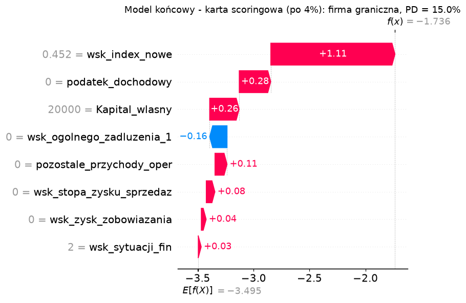

## 9. Analiza kontrfaktyczna

Firma z testu w klasie **BB w obu modelach** (jedna z 14 takich; wiersz 574, PD po δ 10,0% w XGBoost, 8,5% w karcie, bez defaultu):
kapitał własny 231 tys. zł, zerowy podatek i zerowy wskaźnik zysku do zobowiązań, silnie ujemna rentowność sprzedaży (−15,4).
**Zależności między cechami:** zamiast zmieniać jeden wskaźnik, przesuwamy **dźwignie** - grupy cech skorelowanych |ρ| ≥ 0,7
z cechą karty - o tę samą liczbę percentyli rozkładu z train. Niezmienne: sekcja PKD, forma własności, wielkość, wiek oraz
wskaźniki branżowe `wsk_index_*` (firma nie ma na nie wpływu). Podatek dochodowy nie jest dźwignią - jest skutkiem wyniku
finansowego, a nie decyzją firmy; przy dźwigni zysku rośnie o 19% (CIT) przyrostu dodatniego zysku brutto.

- **XGBoost:** jedyna pojedyncza dźwignia, która wystarcza (w zakresie do 80 percentyli), to zysk / zobowiązania (31 cech, m.in. zysk
  netto i brutto, marże, ROA): przesunięcie o 10 percentyli → PD 7,7%, rating **BBB**. Pary z tą dźwignią po 10 percentyli są droższe
  (PD 7,4-7,7%), pary bez niej wymagają po 25 percentyli; pozostałe dźwignie same nie wystarczają. W kwotach: zysk brutto z 0
  do ok. 20,4 tys. zł, podatek do ok. 3,9 tys. zł, zysk netto do ok. 16,7 tys. zł (wariant `Zysk_netto`: 19,2 tys. zł) -
  przesunięcie percentylowe zachowuje relacje księgowe tylko w przybliżeniu.
- **Karta:** brakuje 1,7 pkt (519 → 521, PD < 8%); wystarcza każde z przejść do sąsiedniego przedziału: kapitał własny powyżej
  1,685 mln zł (+8,4 pkt), rentowność sprzedaży z < −8,79 do [−8,79; −0,44) (+2,8 pkt) albo zysk / zobowiązania z [0; 0,046)
  do [0,046; 0,163) (+1,8 pkt); pozostałe przychody o jeden przedział dają tylko +0,6 pkt. **Oba modele wskazują zysk względem
  zobowiązań** jako skuteczną dźwignię; w karcie, przy firmie tuż nad granicą klasy, wystarcza najmniejsza zmiana.
- **Porównanie z wyjaśnieniami:** największe sumy SHAP tej firmy mają dźwignie rentowności sprzedaży (+0,11) i zysku / zobowiązań
  (+0,07) - ta druga daje najtańszy kontrfakt; kapitał (+0,05) i pozostałe przychody (+0,03) podnoszą ryzyko słabo, a zadłużenie
  (−0,02) i sytuacja finansowa (−0,08) je obniżają. Ranking SHAP nie jest więc rankingiem najtańszych zmian. LIME przypisuje cechom
  dźwigni wkłady bliskie zera (0 do +0,01 PD) - nie wskazuje tych dźwigni.
- **Realność i ograniczenia:** odległość kontrfaktu do najbliższej firmy z train (rangi 20 najważniejszych cech) 0,534 wobec mediany
  0,555 i 90. percentyla 0,717 dla firm testowych - kontrfakt leży w obszarze rzeczywistych firm, ale nie dowodzi to jego spójności
  księgowej (np. dwa warianty zysku netto się rozchodzą). Kontrfakt opisuje model, nie przyczynowość; nie uwzględnia kosztu i wykonalności zmiany.

## 10. Audyt podgrup i monitoring

| Segment (test) | n | defaulty | DR | DR / PD karta | DR / PD XGBoost | AUC XGBoost |
|---|---|---|---|---|---|---|
| mikro | 174 | 23 | 13,2% | 0,76 | 0,80 | 0,87 |
| mała | 100 | 14 | 14,0% | 1,08 | 1,37 | 0,78 |
| pozostałe | 325 | 52 | 16,0% | 1,17 | 1,14 | 0,78 |
| forma F215 / F216 | 58 / 58 | 12 / 13 | 20,7% / 22,4% | 1,10 / 1,83 | 1,19 / 1,98 | 0,80 / 0,68 |
| sekcja C (przetwórstwo) | 82 | 14 | 17,1% | 1,69 | 1,85 | 0,70 |

Ryzyko firm mikro jest zawyżane, a formy F216 i sekcji C - zaniżane (przy 13-14 defaultach różnice mogą być przypadkowe);
dla firm małych XGBoost zaniża ryzyko bardziej niż karta (1,37 vs 1,08), a forma F215 mieści się w granicach losowości (1,10-1,19).
Kandydat do korekty segmentowej na większej próbie. Dane nie zawierają cech osób fizycznych.
PSI train → test < 0,05 dla wyniku obu modeli, wszystkich cech karty, `wsk_index_skr_zaw` i cech kategorycznych.

**Monitoring wyjaśnień:** ranking pojedynczych cech SHAP jest niestabilny nawet bez zmiany populacji (Jaccard top-5 0,58 między
foldami, min. 0,43), więc alarm oparty na Jaccard top-5 byłby fałszywy. Monitorujemy **względną zmianę średniego |SHAP| grup
tematycznych** (ranking grup stabilniejszy: ρ rang 0,90, Jaccard top-3 0,70) względem walidacji oraz znaki β karty. Pełny plan
monitoringu - w `MODEL_CARD.md`.

## 11. Porównanie modeli i rekomendacja

| Kryterium | Karta scoringowa | XGBoost |
|---|---|---|
| Skuteczność | Gini 0,562 | Gini 0,583 (różnica +0,021 [−0,048; +0,089] na teście; +0,072 [+0,019; +0,120] na valid) |
| Złożoność | 8 cech, 9 parametrów | 179 cech, 800 drzew |
| Interpretowalność | bezpośrednia (punkty, WoE, znaki β) | pośrednia (SHAP, PDP / ALE, LIME, surogat) |
| Wiarygodność wyjaśnień | dokładne, stabilne (Jaccard top-3 0,60) | SHAP wierny, ale ranking cech niestabilny (0,58; grupy stabilniejsze, ρ 0,90); LIME mało wierny; surogat odtwarza 21-36% odrzuceń |
| Kalibracja | dobra przed δ; δ = −1,280 | dobra przed δ; δ = −1,218 |
| Decyzje (próg z valid) | zysk 47,5 (portfel 4%), 21,95 (test bez wag) | zysk 48,6 (portfel 4%), 21,9 (test bez wag); przy równej akceptacji o 1,65-2,7 wyższy |

**Czy poprawa jakości black-boxa uzasadnia utratę bezpośredniej interpretowalności? Nie.** Przewaga XGBoost jest mała i niepewna:
na teście +0,02 Gini, w granicach niepewności statystycznej (przedział obejmuje zero), na valid +0,07 i istotna. Rekomendacja opiera się
więc na interpretowalności i stabilności: oba modele opierają się na tych samych obszarach (z wskaźnikami branżowymi na czele),
model jest prawie addytywny (słabe interakcje, H ≤ 0,06), karta jest dokładnie wyjaśnialna, a wyjaśnienia black-boxa na poziomie
cech są mniej stabilne i - w przypadku LIME - mało wierne. **Rekomendacja:** karta scoringowa jako model ratingowy, XGBoost jako
*challenger* do monitoringu i wskazywania firm o rozbieżnych ocenach.

**Główne ograniczenia:**
- wskaźniki branżowe `wsk_index_*` wymagają aktualizacji dla każdego okresu, a firma nie ma na nie wpływu (decyzja i rating zależą
  częściowo od kondycji branży);
- selekcja cech karty (IV, filtr korelacji) liczona na całym train - wybór liczby cech w CV jest więc nieco optymistyczny;
- brak ograniczeń monotonicznych w XGBoost (naruszenia do 28% zmienności PDP dla dwóch cech finansowych, 83% dla wieku firmy);
- ALE bez pasma bootstrap - niepewność krzywych nie jest oceniona;
- heurystyczny podział grupowy (brak identyfikatora firmy), brak ekspozycji i daty oceny;
- kotwica 4% przy DR próby 14,8% - PD po δ jest skalibrowane tylko dla portfela różniącego się udziałem defaultów;
- mało defaultów: 89 w valid i 89 w test - szerokie przedziały ufności, niepewne wnioski w podgrupach.
