# Raport techniczny - Projekt 1: model ratingowy z interpretowalnością, wyjaśnialnością i kalibracją do 4%

**Zbiór:** `zbior_13.csv` · **Kod:** `projekt1_rating.ipynb` (wszystkie liczby w raporcie pochodzą z tego notebooka)

## 1. Problem i dane

Budujemy dwa modele szacujące PD - prawdopodobieństwo zdarzenia ryzyka (`default`) dla spółek z o.o. - na podstawie sprawozdań
finansowych: **model interpretowalny** (karta scoringowa WoE + regresja logistyczna) i **black-box** (XGBoost). Sprawdzamy
kalibrację PD, dostosowujemy jej poziom do 4%, mapujemy PD na skalę ratingową i ustalamy próg decyzyjny.

| | Wartość |
|---|---|
| Obserwacje / defaulty / DR | 3 000 / 445 / 14,8% |
| Cechy surowe | 222 (bilans, RZiS, przepływy, wskaźniki finansowe, 3 wskaźniki branżowe `wsk_index_*`, forma własności, PKD, schemat sprawozdania) |
| Cechy do modelowania | 192 liczbowe + 3 kategoryczne (sekcja PKD, forma własności, wielkość jednostki) = 195 |

### 1.1 Jakość danych (Data Quality)
- ±inf w 3 wskaźnikach (np. zerowy mianownik) → zamienione na braki; 7 cech z > 50% braków pominięto w modelowaniu.
- 2 kolumny stałe (`szczegolnaFormaPrawna_Symbol` - same spółki z o.o.); na train wykryto 10 prawie stałych
  i 8 identycznych kolumn, pominiętych w modelowaniu. Kategorie powodów pominięcia mogą się nakładać.
- Typ sprawozdania: `schemat_wsk_bilans` → cecha kategoryczna `wielkosc` (mikro / mała / pozostałe); `schemat_wsk_rzis` pominięty -
  jest zgodny z `schemat_wsk_bilans` w 97,6% obserwacji. Kod PKD zastąpiony sekcją PKD.
- 182 z 192 cech liczbowych ma skośność |s| > 2, mediana udziału dostępnych wartości poza [Q1 − 3·IQR, Q3 + 3·IQR] to 12,7%. **Polityka:** nie
  usuwamy firm (skrajny wskaźnik to często sygnał ryzyka); karta używa binningu kwantylowego (odporny na ogony), drzewa nie
  wymagają cappingu, siatki PDP ograniczamy do kwantyli 2-98% z train.

### 1.2 Przeciek, wskaźniki branżowe i powtarzające się podmioty
- Żadna cecha nie ma AUC jednowymiarowego > 0,85. Trzy wskaźniki `wsk_index_*` (skreślenia / zawieszenia, nowe i aktywne firmy)
  nie występują w słowniku; `wsk_index_skr_zaw` ma średnio ok. 3 wartości na kod PKD, co może wskazywać na kilka okresów.
  Mają najwyższe AUC jednowymiarowe (`wsk_index_nowe` 0,718, `wsk_index_skr_zaw` 0,708) i IV w przedziale „podejrzanie silna”
  (0,61 i 0,58). **Prowadzący potwierdził, że nie zawierają informacji z przyszłości**, więc uwzględniamy je
  wśród kandydatów do modelowania; do karty weszło `wsk_index_nowe`.
  Wnoszą dużo: Gini prostego logitu na valid 0,397 → 0,586. Firma nie ma na nie wpływu, a po wdrożeniu
  trzeba je aktualizować dla bieżącego okresu.
- Brak identyfikatora firmy. Par „ta sama firma rok później” (to samo PKD, forma własności, kapitał, wiek różny o pełne lata ±3 dni)
  jest 61 wobec średnio 35 po losowym przemieszaniu wieku - część firm prawdopodobnie się powtarza. Stosujemy **podział grupowy**:
  51 grup wieloelementowych (109 obserwacji) trafia w całości do jednego zbioru i jednego foldu. Heurystyka może
  połączyć różne firmy lub nie wykryć wszystkich powtórzeń.

### 1.3 Schemat walidacji

```
              ┌──────────── train 60% (1 801) ─────────┐┌─ valid 20% (600) ─┐┌─ test 20% (599) ─┐
dane (3000) → │ uczenie modeli, binning / WoE,         ││ kalibracja kształtu,││ wyłącznie ocena  │
              │ selekcja cech, strojenie:              ││ δ do 4%, próg       ││ końcowa          │
              │ StratifiedGroupKFold(5) wewnątrz train ││ (populacja ref.)    ││                  │
              └─────────────────────────────────────────┘└─────────────────────┘└──────────────────┘
```

Podział `StratifiedGroupKFold` (DR 14,8% w każdym zbiorze, 0 wspólnych grup). Binning i WoE karty oraz kodowanie
kategorii XGBoost dopasowujemy w CV na części treningowej foldu. Listę cech, ranking IV i filtr korelacji karty
wyznaczamy na całym train przed CV, co może zawyżać jej wynik. Kalibracja i próg są wybierane na valid, test służy
do oceny. Brak daty oceny i identyfikatora firmy uniemożliwia podział czasowy i grupowanie według ID. Podział:
`wyniki/podzial.csv`.

## 2. EDA
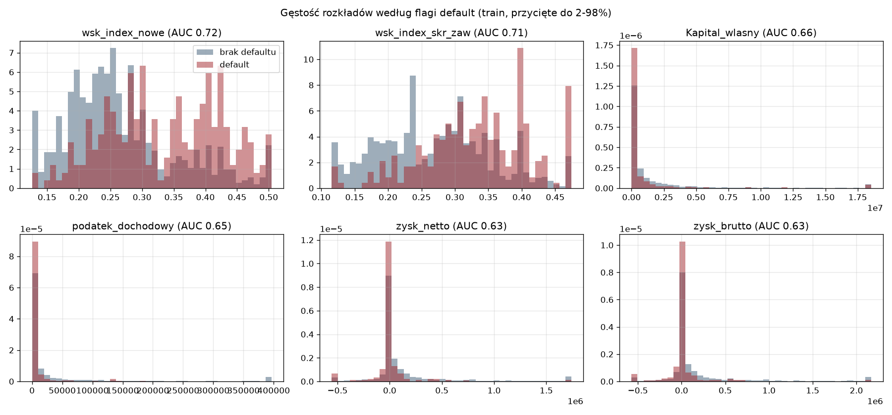
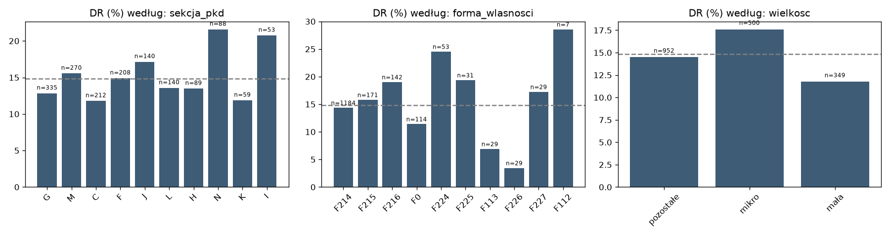

- Najsilniejsze pojedyncze cechy: wskaźniki branżowe `wsk_index_nowe` i `wsk_index_skr_zaw` (AUC 0,71-0,72), dalej kapitał własny,
  podatek dochodowy, zysk netto i brutto, EBITDA, ROA (AUC 0,63-0,66).
- DR różni się między sekcjami PKD, formami własności i wielkością jednostki. Wyniki małych grup interpretujemy ostrożnie.
- Korelacje: 219 par cech ma |ρ Spearmana| > 0,9, 937 par > 0,7 - wiele wskaźników to warianty tej samej miary. Ma to znaczenie
  dla selekcji cech karty, podziału wkładów SHAP, ważności permutacyjnej i analizy kontrfaktycznej.

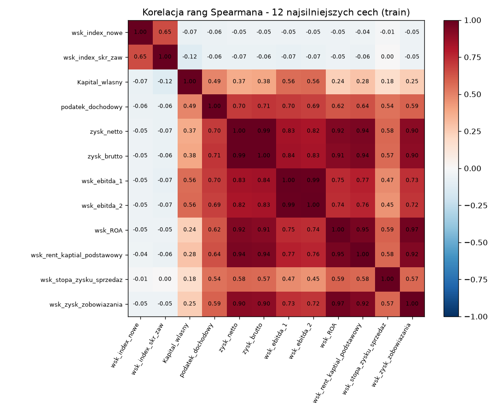

## 3. Model interpretowalny: karta scoringowa

**Przygotowanie cech (train):** binning monotoniczny (`WoEBinner` z Lab 1: ≤ 5 przedziałów, ≥ 5% obserwacji, osobny przedział
`BRAK`), WoE = ln(%dobrych / %złych). **Selekcja:** IV ≥ 0,1 (85 cech) → filtr korelacji |ρ| < 0,6 między WoE (12 cech) →
liczba cech wybrana 5-krotną CV (najwyższe AUC przy k = 8; reguła 1 błędu std. dałaby 3 cechy, co pomija całe obszary oceny).
`wsk_index_skr_zaw` nie wchodzi do karty - jest skorelowany z `wsk_index_nowe` (|ρ| = 0,65).

| Cecha | Obszar | IV | β | p-value | VIF |
|---|---|---|---|---|---|
| wsk_index_nowe | wskaźnik branżowy | 0,610 | −0,938 | < 0,001 | 1,03 |
| podatek_dochodowy | RZiS (proxy zysku) | 0,366 | −0,512 | 0,004 | 2,19 |
| Kapital_wlasny | bilans | 0,322 | −0,434 | 0,009 | 1,79 |
| wsk_ogolnego_zadluzenia_1 | zadłużenie | 0,291 | −0,725 | < 0,001 | 1,22 |
| wsk_zysk_zobowiazania | rentowność | 0,246 | −0,147 | 0,449 | 1,76 |
| wsk_stopa_zysku_sprzedaz | rentowność | 0,220 | −0,403 | 0,040 | 1,71 |
| wsk_sytuacji_fin | sytuacja finansowa | 0,176 | −0,185 | 0,324 | 1,27 |
| pozostale_przychody_oper | RZiS | 0,174 | −0,248 | 0,237 | 1,48 |

- **Znaki:** wszystkie β < 0, zgodnie z konwencją WoE i procedurą selekcji; sam znak β nie gwarantuje zgodności
  zależności z intuicją ekonomiczną. **VIF** < 2,2.
- **Istotność β:** pięć cech ma p < 0,05; trzy najsłabsze (`wsk_zysk_zobowiazania`, `wsk_sytuacji_fin`, `pozostale_przychody_oper`)
  mają p ≥ 0,05. P-value należy interpretować ostrożnie, ponieważ cechy wybrano na tych samych danych.
- **Monotoniczność na nowych danych:** na valid 23 z 29 zmian DR między sąsiednimi przedziałami ma ten sam kierunek co na train.
- **Stabilność w CV:** Gini 0,546 ± 0,105; znaki β ujemne w 39 z 40 przypadków (wyjątek: najsłabsza `wsk_zysk_zobowiazania`, 4 / 5).
- **Karta punktowa:** 600 pkt przy szansach 50:1, PDO = 20; wynik na teście 463-623 pkt (mediana 554), suma punktów zgodna z modelem (sprawdzone).

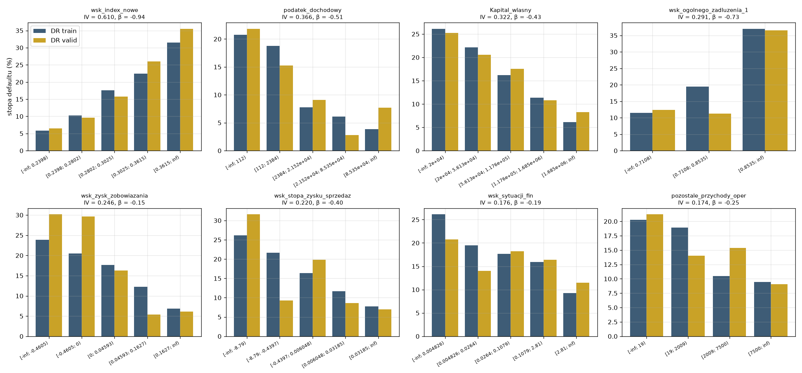

## 4. Model black-box: XGBoost

Wszystkie 195 cech (kategorie one-hot, rzadkie poziomy łączone), bez wag klas. **Strojenie:** losowe przeszukiwanie 40 konfiguracji
w 5-krotnej grupowej CV na train, kryterium log-loss. Wybrano: 800 drzew, głębokość 5, `learning_rate` 0,01, `min_child_weight` 5,
`subsample` 0,6, `colsample_bytree` 0,5, λ = 5, γ = 2 (`wyniki/xgboost_parametry.json`). **Kontrola przeuczenia:** AUC na częściach
treningowych foldów 0,969 vs 0,791 na walidacyjnych. Różnica 0,178 wskazuje na możliwość przeuczenia.

## 5. Porównanie jakości

| Nieważony test (599 obserwacji, 89 defaultów) | Karta | XGBoost |
|---|---|---|
| AUC [95% CI bootstrap] | 0,781 [0,724; 0,833] | 0,792 [0,737; 0,842] |
| Gini | 0,562 | 0,583 |
| KS | 0,440 | 0,457 |
| PR-AUC (losowy: 0,149) | 0,430 | 0,458 |
| log-loss | 0,350 | 0,347 |
| Brier | 0,105 | 0,104 |
| Gini w CV (5 foldów) | 0,546 ± 0,105 | 0,581 ± 0,083 |
| Złożoność | 8 cech, 9 parametrów, 37 przedziałów | 195 cech wejściowych, 170 użytych, 800 drzew, 7 583 liście |

Różnica Gini XGBoost − karta (sparowany bootstrap): test **+0,021 [−0,048; +0,089]**, valid **+0,072 [+0,019; +0,120]**.
Przedział na teście obejmuje zero, więc przewaga jest niepewna. Bootstrap ocenia wyuczone modele bez ponownego uczenia.
Gini między foldami wynosi 0,43–0,66 dla karty i 0,49–0,66 dla XGBoost; CV służyła też do wyboru modeli.

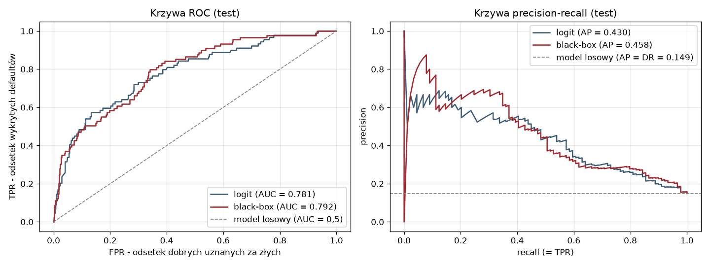

## 6. Interpretowalność i wyjaśnialność

**Ustawienia:** SHAP w log-szansach. Karta - wzór φ_j = β_j·(WoE_j − E[WoE_j]), tło: train. XGBoost - `TreeExplainer`,
wariant **interventional**: przekazano 300 obserwacji train, z których SHAP domyślnie wybiera 100 jako tło.
`tree_path_dependent` stosujemy do wartości interakcji SHAP (6.4). Kolumny one-hot sumujemy do cechy źródłowej.
Maksymalny błąd addytywności na teście to 5,2·10⁻⁶ (XGBoost) i 8,9·10⁻¹⁶ (karta). Wartość bazowa φ₀ wynosi
−2,562 i −2,215 log-szans; σ(φ₀) nie musi być średnim PD.

### 6.1 Wyjaśnienia globalne - najważniejsze cechy

| # | Cecha (XGBoost, średnie \|SHAP\|) | Kierunek (ρ z default, train) | Komentarz ekonomiczny |
|---|---|---|---|
| 1 | wsk_index_nowe (w karcie) | ↑ ryzyko | napływ nowych firm w branży - wysoka rotacja i konkurencja |
| 2 | wsk_index_skr_zaw | ↑ ryzyko | odsetek skreśleń i zawieszeń w branży - kondycja branży w danym okresie |
| 3 | pozostale_przychody_oper (w karcie) | ↓ ryzyko | dodatkowe źródła przychodu, aktywna działalność |
| 4 | Kapital_wlasny (w karcie) | ↓ ryzyko | bufor na straty |
| 5 | podatek_dochodowy (w karcie) | ↓ ryzyko | podatek jako przybliżenie zysku |
| 6–10 | wiek firmy, `wsk_zast_kapitalu_podstawowego`, `Kapital_zapasowy`, `wsk_koszty_przychody`, `wsk_index_aktywne` | — | kolejne cechy według średniego \|SHAP\| |

**Spójność z kartą:** dwie najważniejsze cechy XGBoost to wskaźniki branżowe, a 4 z 5 pierwszych są w karcie.
Korelacja rang ważności ośmiu grup przypisanych do cech karty wynosi 0,62; na pozostałe cechy przypada 53,7% sumy
średnich |SHAP| XGBoost. Zgodność rankingu SHAP z permutacją dla wszystkich cech jest niska (ρ = 0,14).
Metody mierzą różne aspekty ważności, a skorelowane cechy i dobór próby wpływają na wynik.

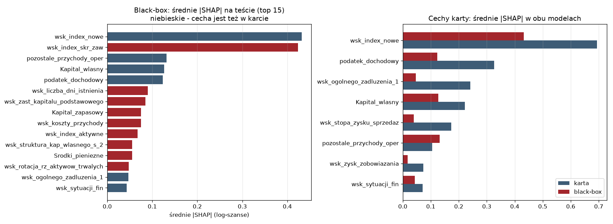
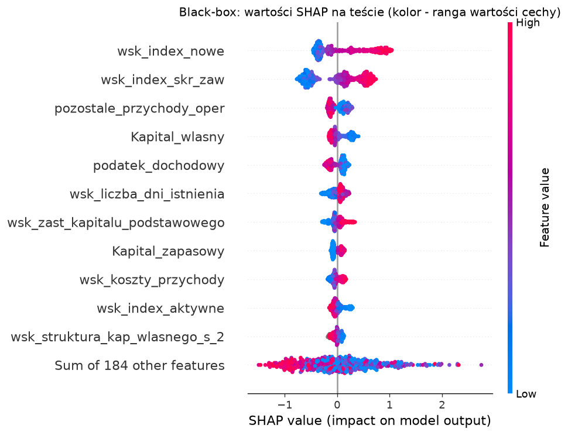

### 6.2 Ważność grup skorelowanych cech (Lab 6)

Tematy z 6.1 (grupy cech skorelowanych |ρ| ≥ 0,7 z cechą karty) oceniamy dwiema metodami z Lab 6: **permutacja grupowa** (cała grupa
mieszana tą samą permutacją, valid, 5 powtórzeń) i **drop-column** (XGBoost uczony od nowa bez grupy). MDI pomijamy - jest liczone
na danych uczących i premiuje cechy ciągłe. AUC black-boxa na valid: 0,8334.

| Grupa (liczba cech) | Permutacja grupy (spadek AUC) | Suma permutacji pojedynczych | Drop-column grupy | Suma \|SHAP\| |
|---|---|---|---|---|
| pozostałe cechy (129) | 0,0802 | 0,0609 | 0,0264 | 2,0749 |
| wsk_index_nowe (1) | 0,0502 | 0,0404 | 0,0086 | 0,4317 |
| zadłużenie ogólne (17) | 0,0218 | 0,0022 | 0,0001 | 0,3253 |
| kapitał własny (8) | 0,0022 | 0,0024 | −0,0023 | 0,3058 |
| podatek dochodowy (2) | 0,0050 | 0,0027 | −0,0020 | 0,1354 |
| zysk / zobowiązania (30) | 0,0049 | 0,0027 | 0,0029 | 0,3056 |

- Permutacja grupy zadłużenia daje spadek AUC 0,0218 przy sumie permutacji pojedynczych cech 0,0022.
- Mały spadek po ponownym uczeniu bez grupy sugeruje, że inne cechy mogą częściowo zastąpić jej informację;
  wynik dotyczy tej próby valid i tego uczenia.
- Korelacja rang: permutacja grupowa vs suma |SHAP| ρ = 0,70, permutacja vs drop-column ρ = 0,92.

### 6.3 PDP / ICE / ALE

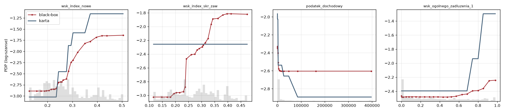
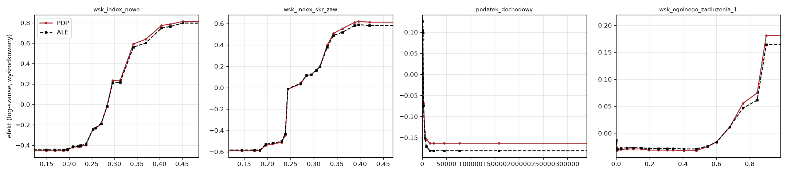

- PDP porównuje modele dla czterech cech (`wsk_index_nowe`, `wsk_index_skr_zaw`, podatek, zadłużenie):
  karta daje schodki, a dla `wsk_index_skr_zaw`, którego nie zawiera, krzywą płaską.
- **c-ICE:** wzrost `wsk_index_nowe` z 0,126 do 0,505 zmienia log-szanse średnio o +1,252 (10. i 90. percentyl
  efektu: +0,920 i +1,560). Średnie efekty: mikro +1,235, mała +1,167, pozostałe +1,287.
- **ALE** (K = 20, min. 20–28 firm w przedziale): maksymalna różnica PDP − ALE wynosi 2,9%, 2,9%, 5,8% i 8,7%
  zakresu ALE dla czterech badanych cech. Nie oszacowano niepewności krzywych.
- **Monotoniczność XGBoost:** udział zmian PDP przeciwnych oczekiwanemu kierunkowi to 0,3% dla `wsk_index_nowe`,
  0,6% dla `wsk_index_skr_zaw`, 6,7% dla zadłużenia, 24,6% dla `wsk_sytuacji_fin`, 27,6% dla
  `pozostale_przychody_oper` i 82,6% dla wieku firmy. Kierunek dla wieku wynika z korelacji na train.
  Binning karty wymusza monotoniczność DR na train w zwykłych przedziałach liczbowych, lecz nie gwarantuje monotonicznego WoE.

### 6.4 Interakcje: statystyka H Friedmana (Lab 6)

Kandydatów wybieramy z wartości interakcji SHAP (path-dependent, 300 firm z testu) - 4 pary o największej średniej |interakcji|.
Każdą parę oceniamy **statystyką H Friedmana** i RMS w log-szansach, na dwóch losowaniach po 150 firm; mają one
39 wspólnych firm. Dodajemy parę kontrolną o najmniejszej interakcji SHAP wśród 10 ważnych cech liczbowych.
Najsilniejsza para według SHAP to `wsk_index_nowe × wsk_liczba_dni_istnienia`: H wynosi 0,061 / 0,060,
a RMS 0,033 / 0,030 log-szans. Dla czterech wybranych par H wynosi 0,043–0,063, a RMS 0,022–0,033.
Wyniki dotyczą tych par i prób; nie dowodzą, że wszystkie interakcje modelu są słabe.

### 6.5 Global surrogate: drzewo naśladujące black-box (Lab 6)

Drzewo regresyjne uczone na log-szansach XGBoost w train (min. 50 firm w liściu), PD drzewa przechodzi ten sam łańcuch kalibracji
i δ. Wierność na teście (39 firm odrzuconych przez XGBoost przy progu operacyjnym z sekcji 8):

| Głębokość | Liście | Wierność R² | Zgodność decyzji | Odrzuceni przez XGBoost odrzuceni też przez drzewo | Zgodność klas | Gini drzewa |
|---|---|---|---|---|---|---|
| 2 | 4 | 0,525 | 93,5% | 0% | 40,7% | 0,350 |
| 3 | 8 | 0,631 | 95,0% | 35,9% | 45,4% | 0,426 |
| 4 | 16 | 0,700 | 94,7% | 20,5% | 50,4% | 0,489 |
| 5 | 22 | 0,733 | 94,7% | 20,5% | 48,7% | 0,493 |
| 8 | 28 | 0,737 | 94,7% | 20,5% | 50,8% | 0,473 |

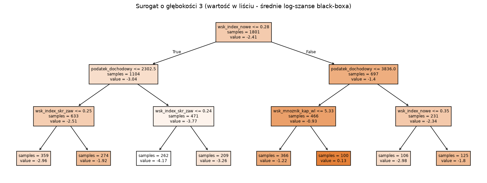

- Drzewo głębokości 3 dzieli najpierw według `wsk_index_nowe` (≤ 0,282), następnie m.in. według podatku
  i `wsk_index_skr_zaw`. Najwyższe PD surogatu wynosi 20,7%.
- Wysoka zgodność decyzji ogółem jest myląca, bo większość firm jest przyjmowana. Surogat głębokości 3 odtwarza
  tylko 14 z 39 odrzuceń; jest uproszczonym opisem, nie zamiennikiem modelu.

### 6.6 Wyjaśnienia lokalne - studia przypadków (test)

| Przypadek | PD XGBoost | PD karta | Default | Główne czynniki (SHAP / karta) |
|---|---|---|---|---|
| najwyższe PD | 80,3% | 68,2% | nie | największe dodatnie wkłady SHAP: dwa wskaźniki branżowe |
| **graniczna** (surowe PD ≈ p* = 18,2%) | 18,153% | 17,9% | nie | największy wkład SHAP: `wsk_index_nowe` |
| firma o medianowym PD | 7,2% | 9,1% | nie | `wsk_index_skr_zaw` obniża wynik względem tła |
| niezgodność modeli | 22,5% | 3,4% | tak | `wsk_index_skr_zaw` podnosi wynik XGBoost, `wsk_index_nowe` go obniża |

Dla karty wyjaśnienie jest bezpośrednie: punkty każdej cechy i „utracone punkty względem maksimum” (kody przyczyn). Dla XGBoost:
wykres kaskadowy SHAP, kody przyczyn, LIME i analiza „what-if”. Pokazane PD są surowe, przed δ. Firmy z dużą różnicą ocen
mogą wymagać analizy; jeden przypadek nie rozstrzyga o ogólnej przewadze modelu.

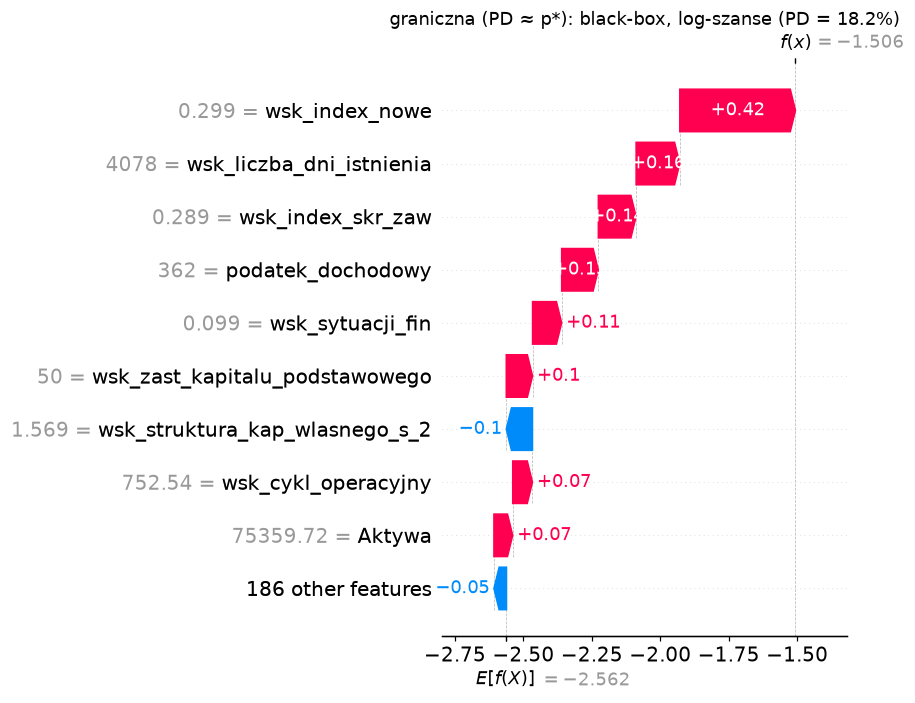
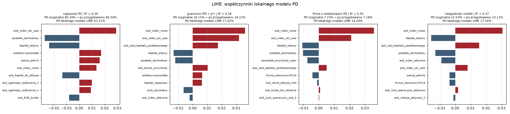

### 6.7 Wierność wyjaśnień (fidelity)
- **SHAP - test zastępowania:** zmiana log-szans dla jednej cechy wynosi średnio 0,648 według rankingu SHAP
  i 0,020 dla losowej; dla 10 cech odpowiednio 0,993 i 0,119. Wynik zależy od sposobu zastąpienia cech.
- **LIME - lokalne R² i błąd aproksymacji** (20 firm, nowe otoczenie losowane jak w LIME):

| Szerokość jądra | R² LIME (mediana) | R² ważone, nowe otoczenie | MAE (pp PD) | \|PD lokalne − PD modelu\| w punkcie (pp) |
|---|---|---|---|---|
| 0,25 × domyślna | 0,021 | −2,773 | 8,987 | 0,071 |
| 0,5 × domyślna | 0,463 | 0,468 | 3,904 | 7,609 |
| 1 × domyślna | 0,473 | 0,491 | 3,907 | 8,560 |
| 2 × domyślna | 0,475 | 0,482 | 3,907 | 8,637 |

Przy domyślnym jądrze mediana błędu w punkcie to 8,56 pp. Węższe jądro zmniejsza ten błąd, lecz daje ujemną
medianę R² w nowym otoczeniu. LIME i SHAP wskazują częściowo różne cechy (Jaccard top-5 0,25–0,67).

### 6.8 Stabilność wyjaśnień
| Eksperyment | Miara | Wynik | Źródło zmienności |
|---|---|---|---|
| LIME, 10 ziaren: 1 000 / 5 000 / 20 000 próbek | Jaccard top-5 | 0,62–0,78 / 0,55–1,00 / 0,73–1,00 | metoda (losowanie) |
| SHAP XGBoost, model uczony na 5 foldach | Jaccard top-5 / top-10 | 0,58 / 0,61; ρ rang 0,78 | model |
| SHAP XGBoost, grupy tematyczne | Jaccard top-3 | 0,70; ρ rang 0,89 | model |
| Karta, 5 foldów | Jaccard top-3 | 0,60; ρ rang 0,83; znaki β 39/40 | model (mało defaultów) |

Więcej próbek LIME często poprawia stabilność, ale nie zawsze; stabilność nie oznacza wierności. Rankingi SHAP zmieniają
się między modelami uczonymi na różnych foldach, także na poziomie grup. Monitoring uwzględnia tę zmienność (sekcja 10).
**Ograniczenia SHAP / LIME:** podział wkładu między skorelowane cechy jest umowny (zależy od wariantu SHAP i struktury drzew),
a wyjaśnienia opisują model, nie zależności przyczynowe.

## 7. Kalibracja

### 7.1 Kalibracja statystyczna (pre-cal → post-cal)
| Valid (przed) | DR | średnie PD | Brier | log-loss | ECE | CITL a | slope b |
|---|---|---|---|---|---|---|---|
| karta | 14,8% | 13,5% | 0,1031 | 0,340 | 0,029 | 0,13 | 1,06 |
| XGBoost | 14,8% | 12,82% | 0,1000 | 0,324 | 0,024 | 0,213 | 1,04 |

Wybór metody - 5-krotna CV wewnątrz valid (log-loss): karta - bez kalibracji 0,3402, Platt 0,3444, beta 0,3447, izotoniczna 0,4002;
XGBoost - 0,3240 / 0,3274 / 0,3280 / 0,3496. Najniższy log-loss i Brier uzyskuje wariant bez korekty kształtu
dla obu modeli, ale nie dowodzi to idealnej kalibracji. Wyniki na teście są zgodne z wyborem z valid.

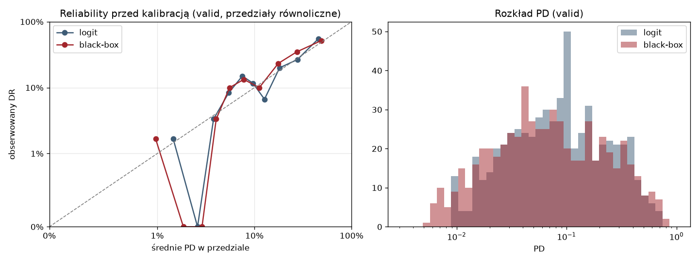
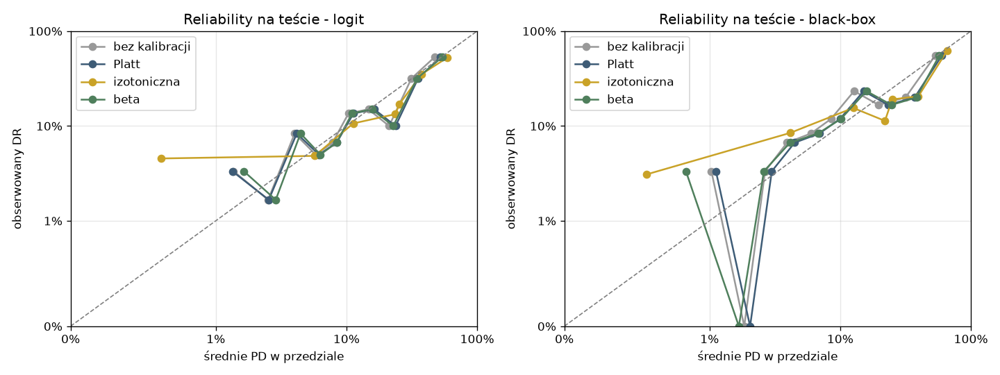

### 7.2 Dostosowanie do tendencji centralnej 4%
logit(q) = logit(p) + δ; δ wyznaczone na valid tak, aby nieważone średnie PD wynosiło 4%:
**−1,486** (karta), **−1,479** (XGBoost).

| Test | średnie PD | DR | AUC | Brier | log-loss | CITL a | slope b |
|---|---|---|---|---|---|---|---|
| karta - przed δ | 14,7% | 14,9% | 0,781 | 0,105 | 0,350 | 0,02 | 0,95 |
| karta - po δ (4%) | 4,4% | 14,9% | 0,781 | 0,124 | 0,441 | 1,50 | 0,95 |
| XGBoost - przed δ | 14,14% | 14,9% | 0,792 | 0,104 | 0,347 | 0,074 | 0,832 |
| XGBoost - po δ (4%) | 4,57% | 14,9% | 0,792 | 0,121 | 0,439 | 1,554 | 0,832 |
| karta - po δ, test przeważony do DR 4% | 3,7% | 4,0% | - | 0,036 | 0,145 | 0,07 | 0,97 |
| XGBoost - po δ, test przeważony do DR 4% | 3,68% | 4,0% | - | 0,035 | 0,144 | 0,095 | 0,85 |

- Ranking i AUC się nie zmieniają; zmienia się poziom PD. Względem próby (DR 14,9%) kalibracja **pogarsza się z założenia**:
  dostosowanie średniej do 4% nie jest poprawą kalibracji statystycznej.
- Test przeważony do DR = 4% jest symulacją opartą na założeniu o rozkładach cech portfela. CITL wynosi
  0,074 / 0,095, a slope 0,97 / 0,85; wynik nie dowodzi kalibracji rzeczywistego portfela.

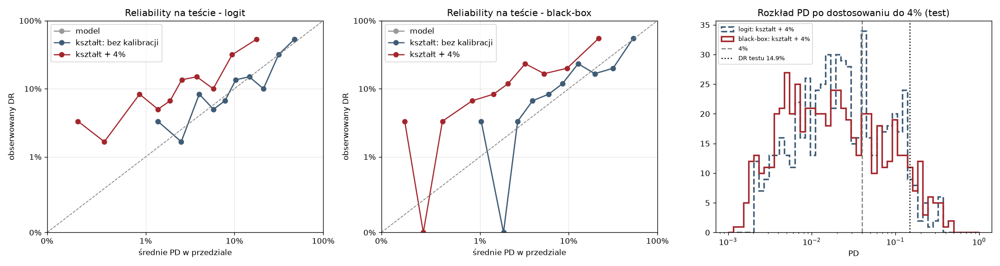

## 8. Progi decyzyjne i ratingi

**Skala:** AAA < 1%, AA 1-2%, A 2-5%, BBB 5-8%, BB 8-12%, B 12-20%, CCC ≥ 20%, D - stwierdzony default.
Rozkład (karta / XGBoost, nieważony test): AAA 27,5% / 37,2%, AA 20,0% / 17,4%, A 25,4% / 20,5%,
BBB 8,5% / 7,0%, BB 9,0% / 7,0%, B 6,8% / 6,5%, CCC 2,7% / 4,3%; HHI 0,201 / 0,227.
**Monotoniczność:** DR karty rośnie od 4,8% (AAA) do 68,8% (CCC); w XGBoost jedno odwrócenie A / BBB
(18,7% vs 14,3%; BBB: 42 firmy, 6 defaultów).
**Backtest:** według Jeffreysa przed δ oba modele mają 6 zielonych i 1 żółte światło (AAA dla karty, A dla XGBoost);
po δ 6 czerwonych i 1 żółte (BBB). Porównanie dotyczy klas wyznaczonych po δ. Testy mogą dać różne wyniki:
dla BBB XGBoost p Jeffreysa wynosi 0,0318, a dwumianowe 0,0538. PD po δ porównujemy z nieważonym testem o DR 14,9%.

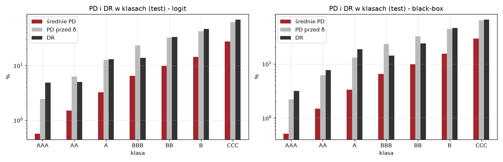

**Funkcja zysku** (marża 10%, LGD 45%, jednakowa ekspozycja): przyjęty dobry +0,10, przyjęty zły −0,45, odrzucony 0;
p* = 0,10 / 0,55 = 18,2%. **Próg empiryczny wyznaczamy na valid przeważonym do DR = 4%** (wykład 3: najpierw δ, potem próg) - tylko
uzyskujemy scenariusz portfela 4%, a nie dowód kalibracji PD. Wynik: **16,5% dla obu modeli** - blisko p*.

| Test | Próg | Akceptacja | DR wśród przyjętych | Zysk |
|---|---|---|---|---|
| karta - portfel 4%, próg z valid | 16,5% | 97,9% | 3,4% | 47,5 |
| XGBoost - portfel 4%, próg z valid | 16,5% | 96,5% | 2,9% | 48,64 |
| portfel 4%, p* (karta / XGBoost) | 18,2% | 98,6% / 96,8% | 3,6% / 3,0% | 47,49 / 48,51 |
| portfel 4%, przyjmij wszystkich | - | 100% | 4,0% | 46,7 |
| portfel jak próba, p* na PD bez δ (karta / XGBoost) | 18,2% | 72,5% / 73,8% | 7,8% / 8,4% | 24,70 / 23,85 |
| portfel jak próba, przyjmij wszystkich | - | 100% | 14,9% | 11,0 |

Wyniki dla portfela 4% są ważone (test przeważony do DR 4%, suma wag 599). Próg empiryczny i p* dają prawie ten sam zysk -
wyniki są scenariuszem, nie gwarancją dla rzeczywistego portfela.
**Tabela decyzyjna (XGBoost, test bez wag, PD po δ):** obniżanie progu z 20% do 3% zmniejsza akceptację z 95,7% do 63,9%,
a DR przyjętych z 12,6% do 7,3%. Próg 8% daje zysk 25,00, a próg z valid 21,90; nie wybieramy progu na teście.
**Porównanie decyzji (test bez wag, progi z valid):** zgodność 96,2%, ten sam rating 51,6%, różnica ≤ 1 klasa 87,5%;
z 23 różnych decyzji 20 to firmy odrzucone tylko przez XGBoost, a 3 tylko przez kartę. Przy przyjęciu 560 firm
zysk wynosi 18,60 / 21,90, a przy 577 firmach 16,45 / 15,90 (karta / XGBoost); wynik karty może zależeć
od rozstrzygnięcia remisu PD na granicy.

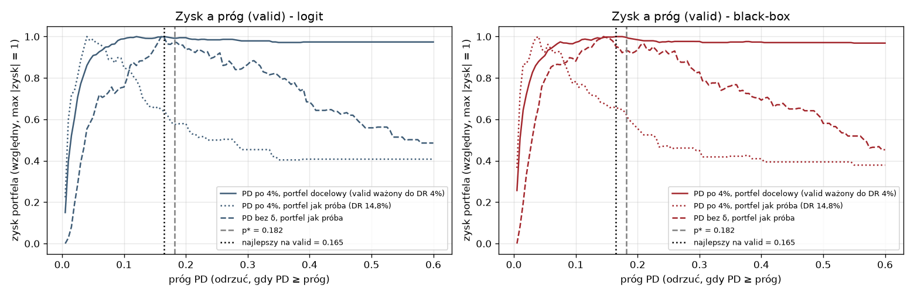

### 8.1 Firma graniczna przy progu operacyjnym: SHAP modelu końcowego

Decyzję podejmujemy na PD po δ i progu 16,5%, więc firmę graniczną wybieramy właśnie tam (XGBoost). Kształtu nie kalibrujemy, a δ jest
stałym przesunięciem logitu, więc **SHAP modelu końcowego = te same wkłady φ, wartość bazowa φ₀ + δ** (wykład 4); kontrola:
φ₀ + δ + Σφ = −1,610 = logit PD końcowego.

Firma (wiersz testu 54): PD końcowe 16,66%, rating B, odrzucona; później wystąpił default. Największe wkłady
podnoszące wynik pochodzą od `wsk_index_nowe` (+0,853) i `wsk_index_skr_zaw` (+0,424); `podatek_dochodowy`
ma wkład −0,175 log-szans. Wkłady opisują model względem tła, nie zależność przyczynową.

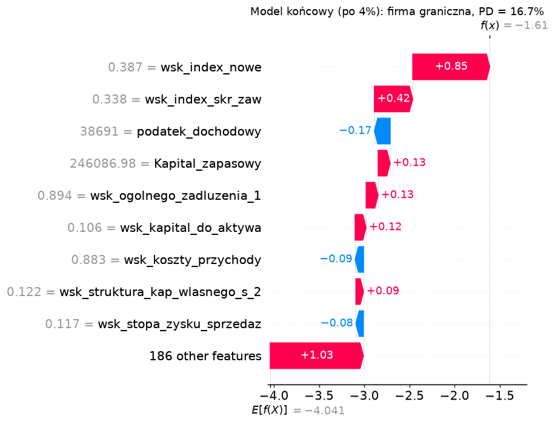

## 9. Analiza kontrfaktyczna

Firma z testu w klasie **BB w obu modelach** (jedna z 13 takich; wiersz 19, PD po δ 10,07% w XGBoost,
9,40% w karcie; później wystąpił default).
**Zależności między cechami:** zamiast zmieniać jeden wskaźnik, przesuwamy **dźwignie** - grupy cech skorelowanych |ρ| ≥ 0,7
z cechą karty - o tę samą liczbę percentyli rozkładu z train. Niezmienne: sekcja PKD, forma własności, wielkość, wiek oraz
wskaźniki branżowe `wsk_index_*` (firma nie ma na nie wpływu).

- **XGBoost:** najtańsza pojedyncza dźwignia to zadłużenie ogólne: przesunięcie o 5 pp percentyla daje PD 7,69%
  i rating BBB. Kilka rozłącznych par osiąga cel przy koszcie 10 pp; pominięto trzy pary o wspólnych cechach.
- **Karta:** do celu PD 7,99% potrzeba ok. 5,1 pkt więcej (około 510 → 515). Żadne z pokazanych przejść
  o jeden przedział nie wystarcza; wybrane przejścia o dwa przedziały dla podatku lub kapitału własnego wystarczają osobno.
- **Wyjaśnienia:** suma SHAP wynosi +0,369 dla dźwigni kapitału i +0,186 dla zadłużenia. SHAP i koszt kontrfaktu
  opisują różne rzeczy. LIME wybrał jedną cechę dźwigni zadłużenia; jego lokalne R² dla tej firmy wynosi 0,243.
- **Ograniczenia:** odległość kontrfaktu do najbliższej firmy train wynosi 0,389 wobec mediany 0,555 i 90. percentyla 0,717
  dla firm testowych. Nie dowodzi to wykonalności: analiza nie uwzględnia rzeczywistego kosztu ani wszystkich zależności księgowych.

## 10. Audyt podgrup i monitoring

| Segment (test) | n | defaulty | DR | DR / PD karta | DR / PD XGBoost | AUC XGBoost |
|---|---|---|---|---|---|---|
| mikro | 174 | 23 | 13,2% | 0,76 | 0,80 | 0,870 |
| mała | 100 | 14 | 14,0% | 1,08 | 1,37 | 0,775 |
| pozostałe | 325 | 52 | 16,0% | 1,17 | 1,14 | 0,778 |
| forma F215 / F216 | 58 / 58 | 12 / 13 | 20,7% / 22,4% | 1,10 / 1,83 | 1,19 / 1,98 | 0,797 / 0,675 |
| sekcja C (przetwórstwo) | 82 | 14 | 17,1% | 1,69 | 1,85 | 0,699 |

DR / PD dotyczy nieważonego testu i PD przed δ. Różnice w podgrupach to sygnały do dalszej analizy, nie dowód
trwałego błędu ani podstawa do automatycznej korekty. AUC liczymy dla grup z co najmniej 10 defaultami i 10 firmami
bez defaultu. PSI badanych wyników i cech na teście jest poniżej 0,05, najwyższe 0,0402 dla sekcji PKD
(na valid 0,0422). Nie dowodzi to stabilności po wdrożeniu.

**Monitoring wyjaśnień:** średni Jaccard top-5 cech XGBoost między foldami wynosi 0,58, a top-3 grup 0,70.
Monitorujemy średnie |SHAP| grup tematycznych oraz wersje i znaki β karty; zmiany znaków oceniamy po ponownym dopasowaniu.
Pełny plan i proponowane progi monitoringu - w `MODEL_CARD.md`.

## 11. Porównanie modeli i rekomendacja

| Kryterium | Karta scoringowa | XGBoost |
|---|---|---|
| Skuteczność | Gini 0,562 | Gini 0,583 (różnica +0,021 [−0,048; +0,089] na teście; +0,072 [+0,019; +0,120] na valid) |
| Złożoność | 8 cech, 9 parametrów | 195 cech wejściowych, 170 użytych, 800 drzew |
| Interpretowalność | bezpośrednia (punkty, WoE, znaki β) | pośrednia (SHAP, PDP / ALE, LIME, surogat) |
| Wiarygodność wyjaśnień | suma punktów dokładnie odtwarza wynik; Jaccard top-3 0,60 | SHAP addytywny; Jaccard top-5 0,58; LIME mało wierny w badaniu; surogat odtwarza 35,9% odrzuceń |
| Kalibracja | bez korekty kształtu; δ = −1,486 | bez korekty kształtu; δ = −1,479 |
| Decyzje (próg z valid) | zysk 47,52 (test ważony do DR 4%), 16,45 (test bez wag) | zysk 48,64 (test ważony do DR 4%), 21,90 (test bez wag) |

**Rekomendacja:** karta scoringowa jako prostszy model podstawowy, XGBoost jako *challenger* do monitoringu i wskazywania
firm o rozbieżnych ocenach. Przewaga XGBoost na teście jest niepewna, a wynik karty można bezpośrednio wyjaśnić punktami.
Miary Jaccarda w tabeli dotyczą różnych wartości top-k i nie służą do bezpośredniego porównania stabilności modeli.
Przed zastosowaniem potrzebna jest walidacja kalibracji i decyzji na danych rzeczywistego portfela.

**Założenia i zakres stosowania:**
- brak daty oceny i identyfikatora firmy wymaga podziału grupowego opartego na heurystyce; stabilność w czasie
  wymaga oceny na danych z kolejnego okresu;
- ranking i selekcję cech karty wyznaczono na całym train przed CV, a liczbę cech i parametry wybrano z użyciem CV;
  wyniki CV mogą być optymistyczne;
- wskaźniki branżowe wymagają aktualizacji dla ocenianego okresu i nie są bezpośrednio kontrolowane przez firmę;
- symulacja portfela 4% zależy od założenia o rozkładach cech i przyjmuje jednakową ekspozycję;
- po 89 defaultów w valid i teście ogranicza pewność wniosków, zwłaszcza w małych podgrupach.
